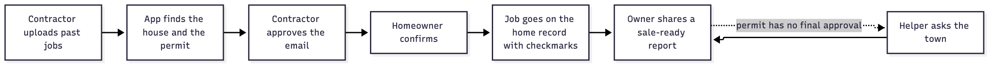
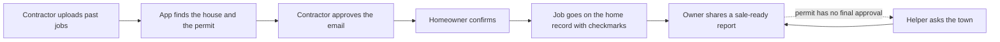
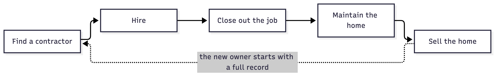
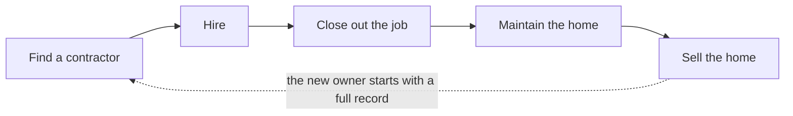

# Closeout — Project Brief

## In one line

Closeout turns a finished home repair into a record of the work that you can trust. The homeowner confirms it, the contractor confirms it, and the town's permit data backs it up.

## The problem

- When work is done on a house, the proof ends up scattered: invoices in email, warranties in a drawer, permits at the town hall.
- Anyone can say "I did good work." There is rarely a way to check it.
- Contractors lose their best proof, which is past jobs, the day the lawn sign comes down.
- Homeowners can't find the warranty when something breaks.
- When a house is sold, buyers and their agents learn about missing permits late, when it's costly to fix.

## What we are building first

A small web app plus an AI helper that does the follow-up work. A person approves every step that matters.

1. **Bring in past jobs.** A contractor uploads their past jobs. The app finds each house on the town map and checks for a matching permit in the state's public data.
2. **Ask the homeowner.** The contractor approves one short email to each past client. The homeowner taps a link, checks the details and confirms. The price stays private by default.
3. **Build the home record.** Each confirmed job goes on the home's record with up to three checkmarks:
   - ✅ Homeowner confirmed
   - ✅ Contractor confirmed
   - ✅ Town permit on file
4. **Make a sale-ready report.** When the owner sells, they share one page with the buyer's agent, the buyer or the home inspector. It shows the verified work, the warranty years and the permit history. Each viewer sees only what the owner allows.
5. **Ask the town when data is missing.** If a permit has no final approval in the state data, the helper drafts a public records request to the town. The owner approves it, the helper waits for the reply and then updates the report.

Diagram source (mermaid — flowchart)

## Who uses it, and how

| Person | What they want | What they do in the app |
|---|---|---|
| **Contractor** (sample: Mike, a builder) | Proof of good work to win new jobs | Uploads past jobs, approves the emails, sees which clients confirmed |
| **Homeowner** (sample: Dana) | One place for the work, the warranties and the permits | Taps a link, confirms the job, chooses what stays private |
| **Buyer's agent** (sample: Tom) | A history of the house they can trust before an offer | Opens the report the owner shared |
| **The team that runs the app** (sample: Priya) | Clean records, no fake jobs, privacy requests handled | Reviews anything the helper wasn't sure about |

All names, jobs and prices in the demo are made up. The permit and map numbers are real public data.

## What the AI helper does, and what it won't do

**It does:**
- Reads invoices and pulls out the date, the price, the type of work and the warranty years. Two different AI models read each one, and if they disagree, the owner is asked.
- Finds the house and the matching permit.
- Fills in fixed email templates. The AI doesn't write the emails.
- Waits days or weeks for replies, sends reminders and picks up where it left off, even after a crash.
- Flags anything it's not sure about instead of guessing.

**It won't:**
- Send any email without a person approving that exact email.
- Email anyone who isn't on the list the owner or contractor gave it.
- Follow instructions hidden inside an uploaded document.
- Send the same email twice.
- Say "open permit." It says "final approval not in state data" and offers to ask the town.

## What we learned from the real data (Manasquan, NJ)

- The state has 2,914 building permits for the town. The newest is from September 2026.
- 93% of permits match exactly one house on the town map.
- 72% of permits older than a year show no final approval in the state data. That's mostly missing paperwork, not unfinished work, so the app asks the town instead of raising an alarm.
- Almost every permit is labelled "Alteration", but the fees on each permit show the trade (building, plumbing, electrical, fire). So a plumbing job is only matched to a permit with plumbing work on it.
- In New Jersey, replacing a roof with the same kind on a detached one- or two-family house usually needs no permit. So "no permit found" is not a warning sign for those jobs. The app never claims a permit wasn't needed, though.

## How it can grow later

Each step reuses what we built before. After each step we check whether it's working, then decide whether to keep going.

| Step | What it adds | Who it helps | Rough time | Keep going when |
|---|---|---|---|---|
| **1. Close out + Sell** (first) | Verified job records, the sale-ready report, asking the town | Contractors, homeowners, buyers | ~10 weeks | It runs from scratch, every test passes and the known gaps are handled |
| **2. Maintain** | Warranty and upkeep reminders, one-tap rebooking with the same contractor | Homeowners, contractors | ~1.5 weeks | People act on the reminders in a small trial |
| **3. Find** | See which contractors did verified work on nearby homes | Homeowners looking to hire | ~2 weeks | A town has enough verified jobs per trade |
| **4. Hire** | The helper gets quotes and lines them up side by side | Homeowners, contractors who opt in | ~3 weeks | Contractors agree to get quote requests |

All four steps together take about 16–17 weeks for one person. Step 1 is the longest because it builds the parts the others reuse, and the tests that check them. These are rough guesses for planning. Step 1 gets re-estimated after its first slice.

Diagram source (mermaid — flowchart)

**Why the later steps are quick:**
- The home record stores events (a job, a permit, a warranty, a reminder, a quote). A new feature is just a new kind of event.
- "Ask someone, wait, remind them, read the reply" is built once. Closeout, the town request, reminders and quotes all reuse it.
- Every action the helper takes goes through the same permission check.
- Every AI decision has tests, so a change that makes it worse fails before it ships.
- Adding a new town means adding a settings entry and that town's map file.

## Tools we plan to use

All free. All open source, except Phoenix (optional) and the hosted AI model we compare against.

| Tool | What it does for us |
|---|---|
| Python | The main language |
| Temporal | Keeps long tasks running for days and recovers after a crash without repeating steps |
| Model gateway (our own small module) | The only part that talks to AI models. It can also play back saved answers, so no AI is needed to run the demo. |
| Postgres | Stores the home records |
| Mailpit | A fake mailbox, so demo emails never reach real people |
| Ollama + Qwen3-VL | Runs a small AI model on our own computer that reads invoice photos (picked by testing; see below) |
| Phoenix (optional) | Shows what the AI did and how long it took (Elastic License, not open source) |
| Docker Compose | Starts everything with one command |

## Ground rules for the demo

- It's an independent project built on public data. It carries no company's name or logo.
- No real homeowner names. Every person in the demo is made up and labelled as sample data.
- It never emails real contractors or homeowners.
- It's a demo, not a finished product, and it doesn't claim to be one.
- Made-up people live in a made-up town, **Sampleton**, labelled on every page. Real Manasquan houses only appear on the data pages, with no people attached.

## Where the plan stands

The plan is in `docs/`. Two independent AI reviewers checked it twice each, and their findings are fixed. The list of changes is in `docs/00-GAPS.md`.

| Doc | What it answers |
|---|---|
| `docs/00-GAPS.md` | What was missing, what we found, and what was decided |
| `docs/01-SPEC.md` | What Phase 1 must do: 47 numbered requirements, each with how we'll test it |
| `docs/02-ARCHITECTURE.md` | The parts and how they talk |
| `docs/03-DESIGN.md` | The details a builder needs: tables, rules, approvals, sending, workflows, privacy |
| `docs/04-EVALS.md` | How we measure "is it good?" with honest numbers |
| `docs/05-TEST-STRATEGY.md` | The kinds of tests, and how we stop AI coding agents from weakening them |
| `docs/06-IMPLEMENTATION-PLAN.md` | 16 small slices, each checkable on its own, and 4 milestones |

**What the model test showed** (full details in `spikes/model-test/RESULTS.md`)

- **Qwen3-VL 4B reads invoices best.** It got 98% of facts right, slightly ahead of the hosted model (97%). It takes about 5 seconds per invoice, is a 3.3 GB download and uses about 4.5 GB of memory.
- **Every model makes things up on blurry photos.** One read a $4,100 total as $84,100.
- **A second read fixes this.** A second model reads every invoice, and the owner is asked when the two disagree. That brought wrong facts to 0 of 270, at a cost of 3 owner questions for 30 invoices. These 30 invoices were also used to pick the models, so a separate set of 300 will measure the real error rate.
- **The vision models ignored hidden instructions** on the 3 invoices that had them. That's too few to prove much, so the build tests 60 attack documents.
- **Small models picked the right next step only 5 to 8 times in 10, and all got date maths wrong.** So the workflow code decides the steps, works out the dates and applies the permit rules. The model only reads documents.
- **Four ways to run it:**
  - Replay: no AI, works on any computer.
  - Light: one 3.3 GB model.
  - Full: two models, about 11 GB of memory.
  - Hosted: one local model plus a hosted one, for comparing cost and speed.

## What's in this folder

| Path | What it is | Goes public? |
|---|---|---|
| `docs/` | The plan: spec, architecture, design, evals, tests, slices | Yes |
| `pages/closeout-prototype.html` | A clickable mock of the finished product. Open it in a browser and press "Walkthrough" for a 16-step tour. | Yes |
| `spikes/model-test/` | The AI model test: 30 made-up invoices, the scripts that ran each model, and the results | Yes |
| `spikes/messy-docs/` | How we'll make messy, real-looking test invoices without hand work, with a working prototype | Yes |

The town map file is 247 MB, so it's not copied here. It's the Monmouth County parcels download from NJGIN (njgin.nj.gov). Private working notes are kept outside this folder, so everything here can go public from day one. A check for private names runs before every push.

## Next step

1. ~~Finish the model test and pick the model.~~ Done.
2. ~~Close the gaps and write the plan.~~ Done. See `docs/`.
3. ~~Decide the open questions.~~ Done: full plan, a separate GitHub account for the coding agent, and messy test invoices made by generators instead of by hand.
4. ~~A second review of the revised plan.~~ Done.
5. Start slice S0: prove the tools work and set up the guards.
