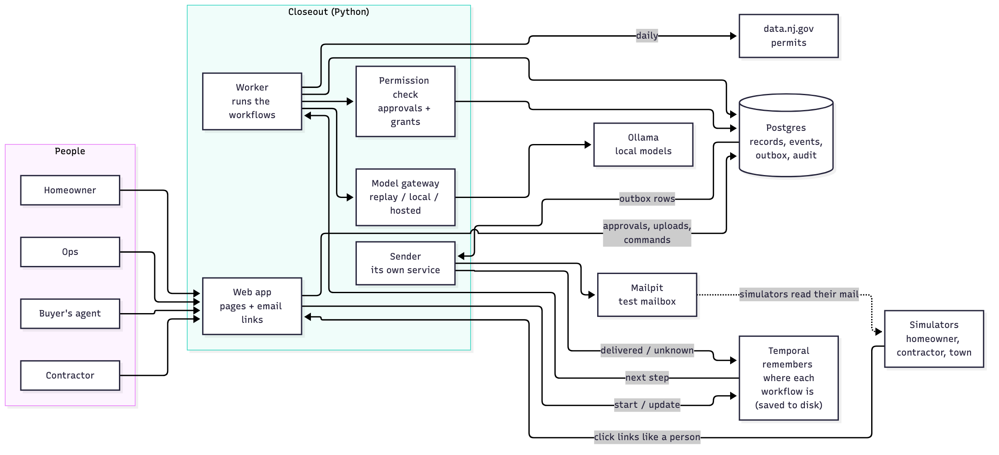
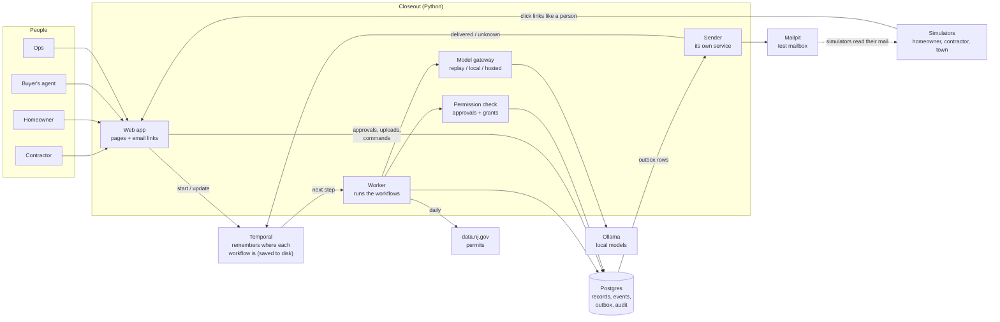
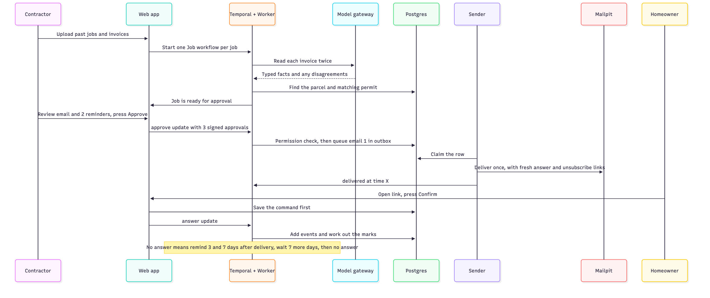
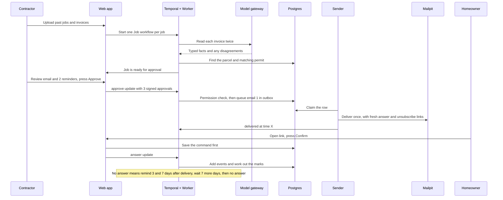
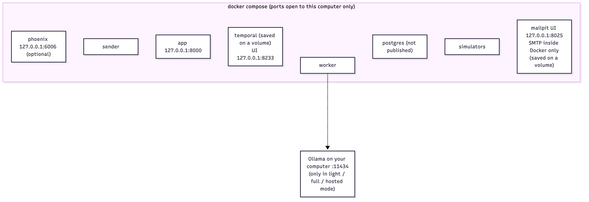
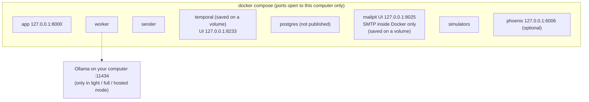

# 2. High-level architecture — the parts and how they talk

## The big picture



<details><summary>Diagram source (mermaid — flowchart)</summary>



</details>

## The parts

| Part | What it does | Built with | Why this choice |
|---|---|---|---|
| **Web app** | Pages for each person, the links in emails, the approval page, the "needs a look" list | FastAPI + Jinja templates + htmx | Server-rendered pages are simple to test with Playwright and need no front-end build. |
| **Temporal** | Keeps every long task (wait 3 days, remind, wait for the town) alive through crashes and restarts | Temporal dev server (MIT license), saving to a file on a Docker volume | It resumes exactly where it stopped, and its test kit can skip time. |
| **Worker** | Runs the workflow code and its steps ("activities") | `temporalio` Python SDK | Workflows are plain Python, so they're easy to test. |
| **Model gateway** | The only place that talks to an AI model. Reads documents with two models and compares them. Plays back saved answers in replay mode. | Thin Python module, Ollama HTTP API, optional hosted API | One door means one place to log, replay, check and swap models. |
| **Permission check** | Every action (send, share, town request) must pass here with a valid approval and an active grant | Python, Ed25519-signed approvals | One choke point is easy to test and impossible to forget. |
| **Sender** | Takes approved messages from the outbox, delivers each at most once, and tells the workflow what happened | Its own small service (container) | It can be killed on its own in crash tests. |
| **Postgres** | All records, the add-only event list, outbox, approvals, audit log, model-call log | Postgres 16 | One reliable store |
| **Mailpit** | Catches every demo email. Nothing leaves the computer. | `axllent/mailpit`, relay turned off, saving to a volume | You can watch the emails arrive, and tests read them through its API. |
| **Ollama** | Runs the local models (Qwen3-VL 4B and 8B) | Installed on your computer (not in Docker on a Mac, so it can use the graphics chip) | Picked by the model test |
| **Simulators** | Pretend homeowners, contractors and the town clerk. They read their mail and click links. | Small Python scripts with fixed, seeded behaviour | The demo and tests never contact real people. |
| **Permit feed** | Daily pull of new and changed Manasquan permits | A Temporal Schedule + the data.nj.gov API | Real public data |
| **Phoenix** (optional, off by default) | Shows each model call's time and cost | Arize Phoenix + OpenTelemetry (Elastic License 2.0, not open source) | Lets you see what the AI did. It's optional because of its license. |

## How a job gets closed out



<details><summary>Diagram source (mermaid — sequence diagram)</summary>



</details>

## What each part may do

These rules keep the system safe, and tests check each one:

1. **Only workflows decide what happens next.** The web app may save what a person did (an approval, an upload, a click) and pass it to the workflow. It never moves a job forward by itself.
2. **Only the model gateway talks to models.** Models get no tools. They return typed fields and nothing else.
3. **Only the permission check (`perform`) writes to the outbox, share links and approved town requests,** and only with a valid approval. The worker calls it for emails, and the web app calls it for share links.
4. **Only the sender sends mail,** and only to Mailpit and made-up domains.
5. **The workflow code decides the steps.** The model never picks the next action. In the model test, small models chose the right step only 5 to 8 times in 10, and all of them got date maths wrong.
6. **Documents are data.** Their text never becomes an instruction, a recipient or a link.
7. **No personal data in places that can't be cleaned.** Workflow histories, click payloads sent to workflows, logs and the add-only tables hold IDs, codes, dates and amounts, never names, email addresses or typed text (design 3.17).

## Workflows

| Workflow | ID | Starts when | Lives for | Main steps |
|---|---|---|---|---|
| `PermitSync` | started by Schedule `permit-sync-1329` | Daily (or `make sync`) | Minutes | Fetch changed permits → clean → match to parcels → add permit events |
| `ImportBatch` | `import-<batch_id>` | Contractor uploads | Minutes | Check the files, make the jobs, start one `Job` workflow each |
| `Job` | `job-<job_id>` | Started by `ImportBatch` (or a homeowner upload in S9) | Until a final state, or until the late-answer or undo window ends (about 30 days, 150 s in the fast-clock demo) | Read → find parcel → check permit → fixes from "needs a look" → wait for approval → outreach → record → undo window |
| `TownRequest` | `town-<request_id>` | The homeowner asks the town | 12 business days, plus a 60-day window for late replies | Approve → outreach to the clerk → read the reply document → update the report |
| `Retract` | `retract-<job_id>-<n>` | The contractor retracts after the undo window | Seconds | Add a retraction event → refresh the views |
| `PrivacyRequest` | `privacy-<request_id>` | Ops gets a request | Minutes | Remove the person's details everywhere (design 3.17) → do-not-contact → audit |

There's one long-lived `Job` workflow per job, so every later click ("fix this fact", "approve", "confirm", "undo") has an open workflow to go to. **Outreach** (send → wait for delivery → remind → collect the answer) is a reusable piece of code that runs inside `Job` and `TownRequest`, not a workflow of its own. Jobs, town requests and (later) upkeep reminders and quotes all use it. Every click is saved first, then passed to the workflow (design 3.5).

## Run modes

| Mode | Models | Who it's for | Memory (measured on the model test) |
|---|---|---|---|
| `replay` (default) | None. Saved answers play back. Only the sample documents can be uploaded. | Anyone, CI, first run | No extra memory for models |
| `light` | Qwen3-VL 4B | Trying a real model on a smaller computer. A person approves every fact on one review screen. | About 4.5 GB for the model |
| `full` | Qwen3-VL 4B + 8B | The real two-read check | About 11 GB for both models |
| `hosted` | One local model + one hosted model | Comparing cost and speed. Needs a key. | About 4.5 GB |

The Docker services add their own memory. That gets measured in S0 and written in the README.

## Running on your computer



<details><summary>Diagram source (mermaid — flowchart)</summary>



</details>

| Command | What it does |
|---|---|
| `make up` | Starts everything and keeps what's there |
| `make down` | Stops everything. Nothing is lost: workflows, records and mail are kept on Docker volumes. |
| `make reset` | Stops everything and wipes it all (database, Temporal, Mailpit, uploads, keys), then loads the seed data |
| `make demo` | `demo-run`: a script plays every role, then prints a pass/fail list of what it checked. Then `demo-open` opens the pages (skipped in CI). |

## Where the code lives

```
closeout/
  src/closeout/
    app/          web pages, email links, approval page, demo sign-in
    workflows/    Temporal workflows (decisions only, no I/O)
    activities/   steps that touch the database, models, mail, the web
    core/         pure logic: rules, cleaners, events → views, signature checks
    gateway/      model gateway: replay, ollama, hosted, two-read compare
    sender/       the outbox sender service
    sims/         homeowner, contractor and town simulators
  data/           seed files, the scripts that rebuild them, SOURCES.md
  evals/          golden sets, truth files, saved model answers, eval runners
  tests/          unit, property, integration, workflow, chaos, e2e, browser
  tools/          trace.py, join_check.py, publish.py and the gate scripts
  deploy/         docker compose files
  Makefile
```

Imports are always `closeout.core.x` and so on. `core/` has no database, network, clock or randomness. It's quick to test thoroughly, including mutation tests. It may use pydantic and rapidfuzz.
