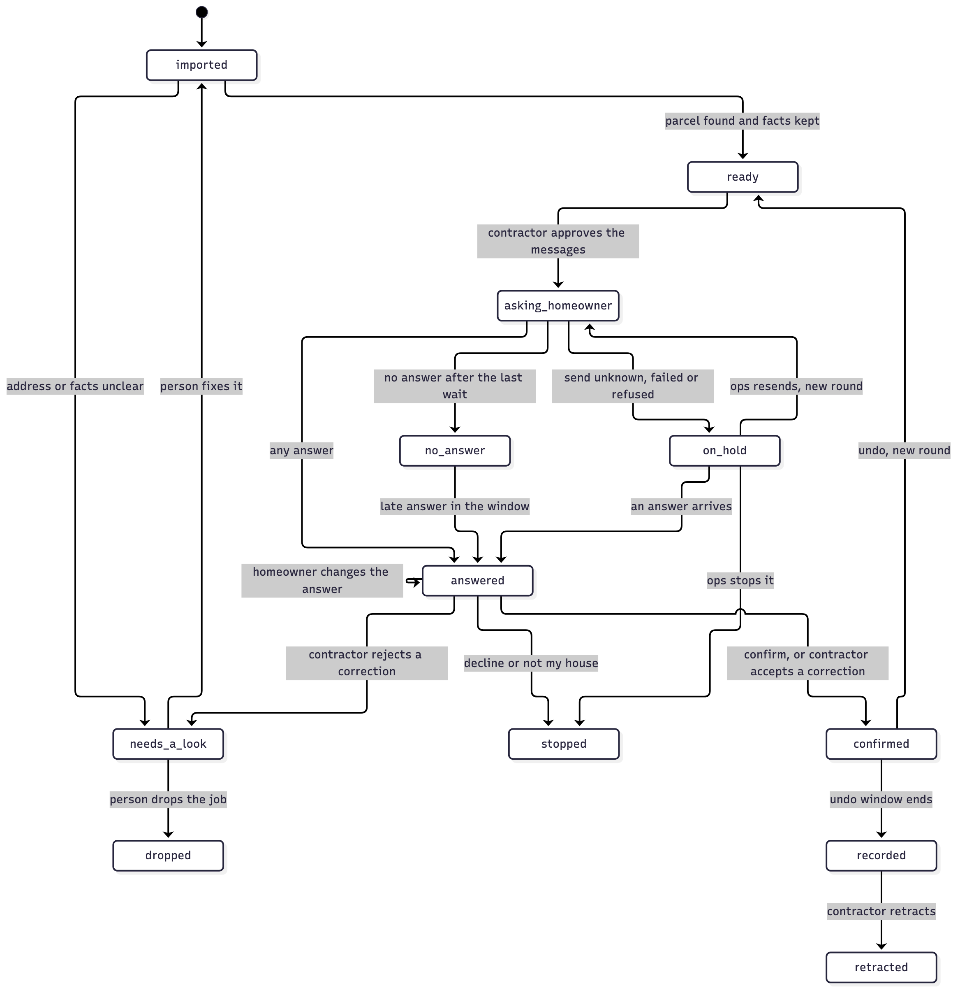
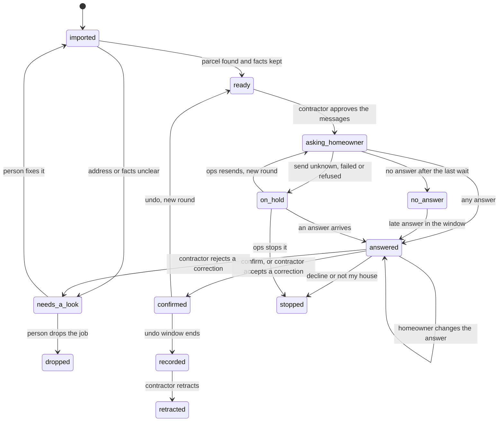
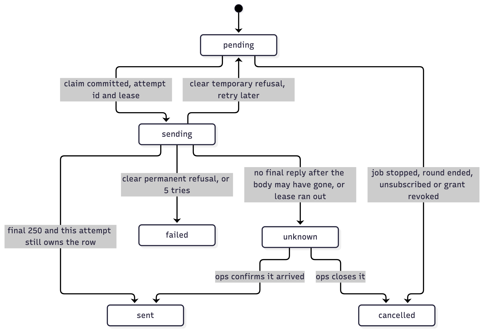
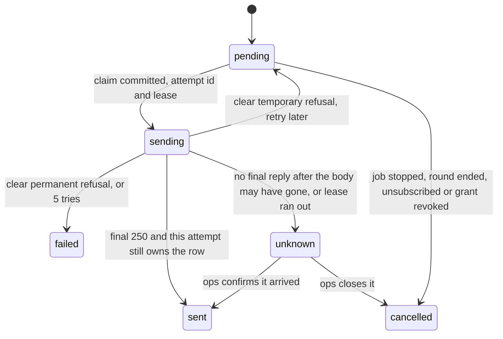

# 3. Detailed design

This doc is meant to be precise enough that a coding agent can build each piece without guessing, and a test can check it. Requirement IDs refer to the [spec](01-SPEC.md). Anything marked **(S0 proves)** gets settled by a small working test in slice S0, and this doc is updated with the result.

## 3.1 Data model (Postgres)

**Tools:** SQLAlchemy 2 Core (no ORM) with `psycopg` 3, and Alembic for migrations.

**Rules for every table**
- `id` (UUID) and `created_at`, except `permits`, which is keyed on the source row's `pk`.
- **Add-only tables** (`events`, `audit_log`): a trigger blocks `UPDATE` and `DELETE`. Test reset uses `TRUNCATE`, which only the test database role may run.
- **Add-only tables never hold personal data.** They hold IDs and non-personal facts (dates, amounts, states). Names, emails, phones and addresses of people live in rows that can be cleaned (3.17).
- **Logs that hold personal data** (`model_calls`, `reads`, `outbox`, `commands`, `approvals`) are never deleted. Their working columns (state, lease, result) change normally. Their personal columns change only through the one redaction function, which blanks them and sets `redacted_at`.

| Table | Key columns | Notes |
|---|---|---|
| `clock` | `epoch_real`, `epoch_virtual`, `scale` | One row, written by `make reset`. The only source of virtual time (3.3). |
| `towns` | `code`, `name`, `synthetic`, `feed_filter` (`treasurycode='1329'`), `clerk_recipient_id`, `settings` | Manasquan `1329` (real), Sampleton `9999` (made up) |
| `parcels` | `pin` (`1329_35_8`), `town`, `block`, `lot`, `qualifier`, `address`, `address_norm`, `house_no`, `unit`, `prop_class`, `year_built`, `lat`, `lon` | From the seed. Owner names are never stored. |
| `permits` | **`pk`**, `town`, `permit_no`, `block`, `lot`, `permit_type`, `trades`, `use_group`, `issued_on`, `final_on`, `final_type`, `cost`, `sq_ft`, `processed_on`, `row_hash`, `missing_from_source_since`, `raw`, `bad_fields` | Source field names in the table below |
| `permit_parcel` | `permit_pk`, `pin`, `status` (`linked` = exactly one parcel / `several` / `none`), `candidates` | R-DATA-3 |
| `sync_runs` | `rows_seen`, `rows_new`, `rows_changed`, `rows_missing`, `finished_at` | One row per sync |
| `contractors` | `name`, `license`, `trades`, `recipient_id` | **Made-up contractor list.** The only source for contractor contact details. |
| `people` | `display_name`, `email`, `phone`, `email_hmac`, `erased_at` | **The one place a person's details live.** Everything else points here by `person_id`. |
| `recipients` | `person_id`, `source` (`owner_entered` / `registry` / `town_setting`), `entered_by` | The only allowed recipients (R-OUT-6) |
| `accounts` | `kind` (`contractor` / `homeowner` / `ops`), `person_id`, `contractor_id` | Demo sign-in |
| `grants` | `account_id`, `actions`, `daily_limit`, `version`, `expires_at`, `revoked_at` | Made with the account (3.6) |
| `homes` | `pin`, `owner_account_id`, `claim_code_hash` | Owners come from the seed or a letter-code claim only (R-REC-4) |
| `import_batches` | `account_id`, `status`, `counts` | |
| `jobs` | `origin` (`contractor` / `homeowner`), `contractor_id`, `batch_id`, `job_ref`, `pin`, `homeowner_recipient_id`, `address_raw`, `work_type`, `stated_like_for_like`, `stated_detached_1_2_family`, `status`, `round`, `content_rev` | `status` is a copy of what the events say. A test checks they agree. |
| `documents` | `job_id` or `town_request_id`, `kind` (`invoice` / `town_reply`), `sha256`, `path`, `mime`, `pages`, `removed_at` | Files live on a volume, named by hash |
| `reads` | `document_id`, `reader` (`A` / `B`), `model`, `model_digest`, `prompt_version`, `output`, `valid`, `errors`, `redacted_at` | One row per model read |
| `facts` | `job_id`, `field`, `value`, `source` (`both_reads` / `one_read` / `registry` / `person` / `csv`), `status` (`kept` / `asked` / `answered` / `unconfirmed`) | What we believe, and why |
| `events` | `event_id` (unique), `stream` (`job-<id>` / `home-<pin>` / `permit-<pk>`), `seq`, `kind`, `v`, `payload`, `actor_account_id` | **Add-only.** `UNIQUE(stream, seq)`. See 3.9. |
| `commands` | `command_id`, `account_id`, `target_workflow`, `kind`, `payload`, `saved_at`, `state` (`saved` / `accepted` / `done` / `rejected`), `result`, `redacted_at` | Every click (3.5). `payload` may hold personal values. |
| `approvals` | `nonce`, `account_id`, `action`, `target`, `round`, `step`, `content_rev`, `to_address`, `claims`, `expires_at`, `used_by_command`, `used_at`, `voided_at` | R-OUT-1. `to_address` is the snapshot taken when the person approved. |
| `outbox` | `command_id` (unique), `message_id` (unique), `approval_id`, `job_id` or `town_request_id`, `round`, `recipient_id`, `to_address`, `subject`, `body_template`, `state`, `attempt_id`, `lease_until`, `attempts`, `next_attempt_at`, `last_error_code`, `sent_at`, `redacted_at` | R-OUT-2. Never holds a raw link token. `last_error_code` is a code, never the server's text. |
| `links` | `token_hash`, `purpose` (`answer` / `unsubscribe` / `share` / `town_reply` / `contractor_confirm`), `target`, `round`, `outbox_id`, `role`, `fields_allowed`, `expires_at`, `revoked_at` | All email and share links (3.11) |
| `suppression` | `email_hmac`, `reason`, `added_at` | Do-not-contact list. HMAC with the server key over the lower-cased, trimmed address. |
| `town_requests` | `home_pin`, `permit_pk`, `status` (`drafted` / `approved` / `sent` / `reminded` / `replied` / `no_reply` / `closed`), `result` (`final_on_file` / `no_record` / `unclear`), `result_date` | R-TOWN |
| `review_items` | `kind`, `ref`, `reason`, `evidence` (IDs only), `resolved_by`, `resolution` | The "needs a look" list (R-OPS-1) |
| `audit_log` | `actor_account_id`, `action`, `target`, `approval_id`, `command_id`, `details` (IDs and codes only) | R-OPS-3. Add-only. |
| `model_calls` | `call_id`, `reader`, `provider`, `model`, `model_digest`, `replay_key`, `response`, `ms`, `tokens_in`, `tokens_out`, `cost_usd`, `redacted_at` | Log only (R-OBS-1). Saved answers for replay are files (3.10). |

**Permit fields from the source** (data.nj.gov `w9se-dmra`)

| Ours | Source |
|---|---|
| `pk` | `pk` |
| `permit_no` | `permitno` |
| `permit_type` | `permittypedesc` |
| `trades` | `buildfee`, `plumbfee`, `electfee`, `firefee` (> 0) |
| `use_group` | `usegroup` |
| `issued_on` | `permitdate` |
| `final_on`, `final_type` | `certdate`, `certtypedesc` |
| `cost` | `constcost` |
| `sq_ft` | `squarefeet` |
| `processed_on` | `processdate` |

`permit_no` values `MISSING` and `+A` are flagged in `bad_fields`.

## 3.2 Rules (pure functions in `core/`)

`core/` may import only the standard library, pydantic, rapidfuzz and `cryptography`. It never reads a clock or makes random values. Those are passed in.

**Address cleanup and matching** (`core/address.py`, R-IMP-2)
- Upper-case, collapse spaces, drop the town and ZIP.
- Shorten suffixes (Lane → LN, Street → ST, Avenue → AVE…).
- Split out the house number (with any letter, like `12A`) and the unit (`Unit 3`, `#3`, `Apt 3`).
- Match only when the **house number and unit are exactly equal**. The street name must then be equal, or the single close match (rapidfuzz ratio ≥ 92) among that town's streets.
- Number ranges (`10-12 MAIN ST`), two or more parcels with the same address (12 in Manasquan), or a unit with a condo qualifier → "needs a look".

**Fact cleanup** (`core/clean.py`, R-IMP-5)
- **Invoice date:** parse many formats. Must fall between 1950 and the given date + 30 days.
- **Invoice money:** an exact decimal between 0 and 5,000,000.
- **Permit cost:** no upper limit. Over 50,000,000 is flagged.
- **License:** must match `\d{2}VH\d{8}` after removing spaces and labels.
- **Work type:** one of the fixed list in the permit table below.
- **Text fields:** links, email addresses, control characters and anything over 200 characters are removed and flagged.

**Two-read agreement** (`core/compare.py`)
- After cleanup, values agree if:
  - dates are equal
  - money is within $0.01
  - names are equal after lower-casing and removing punctuation and "LLC/Inc/Co"
  - addresses are equal after address cleanup
- A disagreement or an invalid read means `facts.status = asked`, with both values shown.

**Same contractor?** (R-IMP-4)
- The invoice is from the uploader if the license read from it is within one character of the uploader's license, or the name matches at a ratio of 0.85 or more.
- A different contractor's license or name → "needs a look".
- The uploader's details always come from `contractors`.

**Permit match** (`core/permits.py`, R-COR)

The rule table is a function, not a module-level dict, so mutation tests reach it.

| Work type | Counts when the permit has… |
|---|---|
| addition | type Addition or New (any trades) |
| deck | type Addition or Alteration, with building |
| kitchen, bathroom | type Alteration, with building, plumbing or electrical |
| windows, roof | type Alteration, with building |
| hvac | type Alteration, with fire, plumbing or electrical |
| plumbing | type Alteration, with plumbing |
| electrical | type Alteration, with electrical |
| other | never matched. Shows "No permit check for this kind of work". |

- **Trades:** `buildfee > 0` → building, `plumbfee > 0` → plumbing, `electfee > 0` → electrical, `firefee > 0` → fire.
- **No trade data:** 280 Manasquan permits have all four fees at zero.
- **Window:** issued between finish date − 365 days and finish date + 14 days.

Results, checked in this order:

| Result | When | Mark? |
|---|---|---|
| **Town permit on file** | Exactly one permit counts | Yes |
| **Possible permits** | Two or more count. The contractor picks one on the job page (the mark then says "picked by contractor") or sends it to "needs a look". The job can be approved meanwhile. | After a pick |
| **Permit with no work details** | No permit counts, but a permit in the window has no trade data: "A permit was issued for this address in this period. State data doesn't show what work it covered." | No |
| **No matching permit found** | Nothing in the window | No |

- **Roof and windows (R-COR-2):** we never claim a permit wasn't needed. If no permit counts and the contractor ticked both "same-size replacement" and "detached one- or two-family home", the page adds: "The contractor stated this was a same-size replacement on a detached one- or two-family home. These usually don't need a permit (state rules)." Property data never turns this line on.
- **Cost** is shown next to the permit for a person to judge. It's not part of the rule.
- **Later permits:** each `PermitSync` re-checks unmarked jobs on parcels whose permits changed and adds `permit.matched` if one now counts.
- **Banned phrases:** "open permit", "unpermitted", "illegal", "violation" (R-COR-3). `core/wording.py: check_text(s)` runs on every rendered page in tests and inside the sender before delivery. Town letters are never shown as text. The report shows only the structured result (3.8), and the original file is a download for the home's owner only.

**Business days** (`core/dates.py`)
- Weekends and NJ state holidays from a fixed list (2024–2030) are skipped. After 2030, only weekends are skipped, and a warning is logged.
- Always computed on **virtual dates** (3.3).

## 3.3 Time

There are two kinds of time, and they never mix:

| Kind | Used for | Read from |
|---|---|---|
| **Virtual time** | Business waits: reminders, town waits, business days, "today" for date checks, daily limits | `virtual(t) = epoch_virtual + (t − epoch_real) × scale`, from the one `clock` row. Every workflow gets `epoch_real`, `epoch_virtual` and `scale` as input when it starts, so they're saved in its history. Workflows apply the formula to `workflow.now()`. |
| **Real time** | Security: approval, link and grant expiry, leases, SMTP timeouts | The database's `now()` when the check runs. Never passed in, so a retried activity checks against the time it actually runs. |

- `/clock` returns virtual now from the same row, and the simulators use it.
- Tests set the epoch to a fixed Monday.
- Activities never call `datetime.now()`. A code scan checks this.

| Wait | Normal | Demo (scale 17,280: 1 day = 5 s) | Restart tests and the M2 restart step (scale 1,440: 1 day = 60 s) | Kind |
|---|---|---|---|---|
| Reminder 1 after delivery | 3 days | 15 s | 3 min | virtual |
| Reminder 2 after delivery | 7 days | 35 s | 7 min | virtual |
| Last wait after reminder 2 | 7 days | 35 s | 7 min | virtual |
| Late-answer window (`Job` stays open) | 30 days after the first delivery | 150 s | 30 min | virtual |
| Town: wait, reminder, wait | 7 + 5 business days | about 85 s | about 17 min | virtual business days |
| Town late-reply window | 60 days | 300 s | 60 min | virtual |
| Backup check for a delivery result | every 10 min | every 5 s (floor) | every 10 s | virtual, with a real-time floor of 5 s |
| Undo window | 10 min | **60 s** | 60 s | real-time floor |
| Approval, answer, share link expiry | 30 / 30 / 14 days | same | same | **real, never scaled** |
| Sender lease | 2 min (setting) | 2 min | 2 min | real. Chaos tests set it to 5 s. |
| SMTP timeout | 30 s (setting) | 30 s | 30 s | real. Chaos tests set it to 2 s. |
| Permit feed | daily | daily (paused in replay mode) | — | real, never scaled |

A link works only while its workflow is open **and** before its real expiry. After that, the page says "This request has closed".

## 3.4 Job states



<details><summary>Diagram source (mermaid — state diagram)</summary>



</details>

- Each move is one function: `core/jobs.py: next_state(state, event) -> state | Refused`.
- **Final states:** `dropped`, `stopped`, `retracted`. A job in `no_answer` becomes final when the late-answer window ends.
- `answered` holds the homeowner's latest answer until it's settled:
  - a confirm settles at once
  - a correction waits for the contractor
  - a decline or "not my house" moves to `stopped`
  - the homeowner can change an answer (except to `stopped`, which settles at once) through the same link
- `not my house` opens a review item, and nothing more is ever sent for that job.
- **A new round** (`round + 1`, new command IDs and links) starts whenever a job re-enters `ready` or ops resends from `on_hold`. Unused approvals and links of the old round are voided.
- **Refusals while sending.** These all move the job to `on_hold` with a review item naming the reason:
  - a reminder that `perform` refuses (`stale_job`, `over_limit`, `grant_revoked`, `expired`)
  - an outbox row ending `failed` or `unknown`
- **Unsubscribe** doesn't change the job state. It cancels queued messages and stops further reminders, and the homeowner can still answer.

## 3.5 How clicks reach workflows

Every click is a **command**. The same steps every time:

1. The web handler checks the session or link itself (hash, purpose, real expiry, round).
2. It saves a `commands` row: a new `command_id`, `saved_at`, and the values the person typed in `payload` (cleanable, 3.17).
3. It sends a Temporal **update** with **update ID = `command_id`**. The update carries only `command_id`, `kind` and IDs, never typed values.
4. **Validator** (runs first, synchronously, workflow state only):
   - Has this `command_id` been handled? → return the stored result. A re-sent click is never refused.
   - Does `next_state` allow this kind now? Windows are judged by `saved_at`, not arrival, so an undo pressed in time and delivered late still counts.
   - If not → reject with a reason code.
5. **Handler:** puts the command on the workflow's queue and waits for its result. One loop in the workflow takes commands in order, loads the payload through an activity, applies it and records the result. Two commands never interleave. The workflow waits for `all_handlers_finished()` before it ends.
6. **The web page** waits up to 5 s for the update to be accepted. Then:
   - accepted → "Done", or "Working on it" (the page then polls `commands.result`)
   - rejected → shows the reason
   - no answer in 5 s → "Saved — we'll process it shortly"
7. **The sweep:** the worker re-sends `saved` commands every 30 s and when it starts. The same update ID means Temporal returns the first outcome. If the workflow has closed, the command is marked `rejected: workflow_closed` and not retried.
8. Results that need the database (a refused approval, an over-limit grant) come from the handler's activities. They're written to `commands.result` and the page shows them.

| Workflow | Command | Allowed when |
|---|---|---|
| `Job` | `fix_fact`, `drop` | `needs_a_look` |
| `Job` | `approve` (approval IDs for the round's messages) | `ready` |
| `Job` | `answer` (link ID, answer kind) | `asking_homeowner`, `answered`, `no_answer`, `on_hold` |
| `Job` | `accept_correction`, `reject_correction` | `answered` with a pending correction |
| `Job` | `pick_permit` | any state before `recorded` |
| `Job` | `undo` | `confirmed`, within the window by `saved_at` |
| `Job` | `unsubscribed` | any open state |
| `Job` | `ops_resend` (with new approvals), `ops_stop` | `on_hold` |
| `TownRequest` | `approve`, `reply` (document ID) | `drafted` / `sent` or `reminded` or late window |
| `Job`, `TownRequest` | `delivered(outbox_id, state, sent_at)` | **signal** from the sender. Ignored unless its outbox row belongs to the current round. |

`/runs` reads from the database (events, outbox, commands), not from Temporal queries, so it works for closed workflows and with the worker down.

## 3.6 Approvals and the permission check

**What a person approves**

| Action | Who approves | What the page shows | One approval per |
|---|---|---|---|
| `send_email` (job) | the contractor | the first email and both reminders: subject, exact text with link slots `{{ANSWER_LINK}}` and `{{UNSUB_LINK}}`, recipient address | message |
| `send_email` (town) | the homeowner | the request and one reminder, same detail | message |
| `share_report` | the homeowner | role, fields shown, expiry | share link |
| `send_email` (contractor confirm, S9) | the homeowner | the email to the contractor | message |

**Approval claims**

```
{ "v":1, "action":"send_email", "account_id":"<uuid>", "target":"job-<id>",
  "round":1, "step":"first", "content_rev":4,
  "to_address_hmac":"<hex>", "subject_sha256":"<hex>",
  "body_template_sha256":"<hex>", "grant_id":"<uuid>", "grant_version":3,
  "exp":"2026-12-31T12:00:00Z", "nonce":"<128-bit random, base64url>" }
```

For `share_report`, the claims are:
- `target: "home-<pin>"`
- `role`
- `fields_sha256`
- `link_hash`
- `link_expires`
- the same `account_id`, `grant_*`, `exp` and `nonce`

**The content of the claims**
- `content_rev` goes up only when something shown in the message changes: the facts in the email, or the recipient. Approving, sending, reminders and answers don't change it.
- `to_address_hmac` is an HMAC with the server key, so it can't be reversed by guessing. The address itself is snapshotted in `approvals.to_address` at approval. Every send in the round goes to that snapshot. A later contact edit only affects the next round.

**Format**
- **Serialisation:** `json.dumps(claims, sort_keys=True, separators=(",", ":"), ensure_ascii=True)`. Timestamps are UTC to the second, ending in `Z`.
- **Token:** `base64url_nopad(claims) + "." + base64url_nopad(Ed25519 signature)`. A token that doesn't re-encode to exactly the same string is `malformed`, so a changed last character can't slip through.
- **IDs:**
  - `NAMESPACE = uuid5(NAMESPACE_URL, "https://closeout.test/ids")`
  - `command_id = uuid5(NAMESPACE, f"{target}:{round}:{step}")` for sends
  - `message_id = f"<{uuid5(NAMESPACE, 'msg:' + str(command_id))}@closeout.test>"`
  - Test vectors live in `tests/vectors/`.
- **Keys:**
  - The web app holds the private key. The worker and sender get only the public key and the HMAC key. Key files are mounted one by one, and a config test checks the worker can't read the private key.
  - `make keys` creates them on the first `make up`. `make reset` makes new ones.

**`core/approval.py: check_signature(token, expected, public_key)`** (pure) returns `Ok(claims)` or one of:
- `malformed`
- `bad_signature`
- `wrong_action`
- `wrong_target`
- `wrong_round`
- `wrong_step`
- `wrong_account`
- `wrong_recipient`
- `subject_changed`
- `body_changed`
- `stale_content`

Expiry is not checked here, because it needs real time. Hash and signature comparisons are constant-time.

**`perform(command)`**
- This is the **only** code that writes to `outbox`, share `links` and approved `town_requests`. It lives in `closeout.act`.
- The worker calls it through an activity for emails. The web app calls it directly for share links, generating the token itself and passing in only its hash, so the raw token never enters a workflow.
- The web app may insert a `drafted` town request. Only `perform` moves it to `approved`.

It does this in **one database transaction**:
1. **Same command already done?**
   - The same `command_id` with the same request fingerprint → return the recorded result. This runs **before** any expiry check, so a retry after a delay still succeeds.
   - The same `command_id` with a different fingerprint → `command_conflict`.
2. Look up the approval by nonce:
   - missing → `unknown_nonce`
   - voided → `voided`
   - used by another command → `already_used`
3. `check_signature` against what's being done now.
4. Check real expiry with the database `now()` → `expired`.
5. Ownership:
   - The approving account owns the target (the job's contractor, the home's owner) → else `not_owner`.
   - The recipient belongs to the target (this job's homeowner, this town's clerk, this job's contractor) → else `wrong_recipient`.
6. Lock the grant row: active, same version, under the daily limit counted in **virtual** days → else `grant_revoked`, `grant_expired` or `over_limit`.
7. Check the recipient isn't suppressed → else `suppressed`.
8. Insert the outbox row (or link, or update the town request). Mark the approval used. Write the audit row.

**Grants** are made with each account in the seed:
- contractors: `send_email`, 200 a day
- homeowners: `send_email` to their town's clerk and to registry contractors, plus `share_report`

Revoking a grant cancels every `pending` row it covers, in the same transaction.

## 3.7 Outbox sender (at most once)



<details><summary>Diagram source (mermaid — state diagram)</summary>



</details>

**The claim is the permission boundary.** Transaction 1 is committed before any network call:
- `SELECT ... FROM jobs WHERE id=:job FOR SHARE`, then check:
  - the job is still waiting on this round
  - the grant is active
  - the snapshot address isn't suppressed
- `UPDATE outbox SET state='sending', attempt_id=:new, lease_until=now()+:lease, attempts=attempts+1 WHERE id=:id AND state='pending' AND next_attempt_at <= now() RETURNING *`
- Make the answer and unsubscribe link tokens and store only their hashes in `links` (bound to this round and outbox row).

Anything that stops a job (answer, decline, undo, unsubscribe, grant revoke, ops stop) takes `FOR UPDATE` on the job row and cancels its `pending` rows in the same transaction. So a stop and a claim can't overlap. A message whose claim committed before the stop may still be delivered. The spec says so (R-OUT-5).

**Send:**
- fill the two link slots
- run `check_text`
- check the recipient domain is `.example` or `.test`
- deliver with `smtplib`, with the SMTP timeout setting

**SMTP stages and outcomes**

| Stage | Reply | New state |
|---|---|---|
| Connect, `EHLO`, `MAIL FROM`, `RCPT TO` | connection refused or dropped, or 4xx | `pending`, retry later |
| Same | 5xx | `failed` |
| `DATA` command | 4xx | `pending` |
| `DATA` command | 5xx | `failed` |
| Body sent, final reply | 250 | `sent` |
| Body sent, final reply | 4xx (clearly not accepted) | `pending` |
| Body sent, final reply | 5xx | `failed` |
| Body sent | no final reply (timeout, dropped) | `unknown` |

- **Retry spacing:** `next_attempt_at` = now + 5 s, 30 s, 2 min, 10 min, 30 min. After the 5th try → `failed`.
- **Finish (transaction 2):** `UPDATE ... WHERE id=:id AND attempt_id=:mine AND state='sending'` for every outcome. If no row changes, a newer state won, so the sender logs a "late result" and changes nothing.
- **Reaper:** each sender loop moves `sending` rows whose lease has ended (by `now()`) to `unknown`.
- **Telling the workflow:** after `sent`, `failed` or `unknown`, the sender signals `delivered(outbox_id, state, sent_at)`. The workflow also checks through an activity on the backup schedule in 3.3. Reminder timers start from `sent_at`, converted to virtual time.
- **Startup checks:**
  - the SMTP host is `mailpit` or loopback
  - Mailpit's API answers at `MAILPIT_API_URL`
  - otherwise the sender refuses to start (R-OUT-7)

**The crash test** (`tests/chaos/test_outbox_crash.py`)
- Fault points sit at exact protocol places.
- A small fake SMTP server (`aiosmtpd`) gives the refusals and stalls that Mailpit can't.
- Each point must end in its stated state:

| Fault point | Expected end state | Copies delivered |
|---|---|---|
| No fault (control) | `sent` | exactly 1 |
| Before the claim | `sent` after restart | exactly 1 |
| After the claim commits, before connecting | `unknown` once the lease ends | 0 |
| After `RCPT TO`, before `DATA` | `unknown` once the lease ends | 0 |
| After the body is sent, before the final reply | `unknown` | 0 or 1 |
| After 250, before transaction 2 | `unknown` | exactly 1 |
| After transaction 2, before the signal | `sent`. The workflow learns by its backup check. | exactly 1 |
| Fake server says 451 to `RCPT`, then recovers | `pending`, then `sent` | exactly 1 |
| Fake server says 550 | `failed` | 0 |
| Mailpit down, back within 30 s | `pending`, then `sent` | exactly 1 |
| Two senders at once | `sent` | exactly 1 |
| Worker killed inside `perform`, after commit | the retry returns the same row, then `sent` | exactly 1 |
| Homeowner declines while a reminder is `pending` | `cancelled` | 0 |

The test counts copies per `command_id` across all rows. A sender that never sends fails the control row.

## 3.8 Workflows (Temporal, Python)

Workflow code only makes decisions. Everything that touches the outside world is an activity.

**`Outreach` is a class, not a workflow.** It runs inside `Job` and `TownRequest` and keeps the send → wait for delivery → remind → collect answer steps in one place. Every command and signal goes to the parent workflow, which passes it to its `Outreach`. That's why there's no forwarding and no separate ID.

| Workflow | ID | If already running | If one with this ID has ended |
|---|---|---|---|
| `Job` | `job-<job_id>` | use the existing one | refuse (a re-import makes a new job) |
| `ImportBatch` | `import-<batch_id>` | use existing | refuse |
| `TownRequest` | `town-<request_id>` | use existing | refuse |
| `Retract` | `retract-<job_id>-<n>` | use existing | refuse |
| `PrivacyRequest` | `privacy-<id>` | use existing | refuse |

- `ImportBatch` starts each `Job` through an activity using the client, so jobs live on after the batch ends.
- **`Job` lifetime:** until a final state, or until the late-answer window or the undo window ends. Then it closes.
- **`TownRequest` lifetime:** the reply waits, then the late-reply window (3.3). A late reply is recorded like any other. After the window closes, the request is `no_reply`.
- **Town replies** are shown only when both reads agree on the result and the date. Otherwise the result is `unclear` and a review item goes to ops. The homeowner is never the one who settles a disagreement about their own home.

**`PermitSync`**
- Schedule `permit-sync-1329` runs it daily, with overlap set to "skip" and a 1-day catch-up window.
- The worker creates the Schedule at start, or updates it if it exists. It's paused in replay mode. `make sync` triggers it once.
- **Each run fetches the whole town:** one request, about 2,914 rows and 0.9 MB, ordered by `pk`, paged at 1,000 rows. It then compares each row by `row_hash`:
  - new rows are inserted
  - changed rows are updated
  - rows that have disappeared get `missing_from_source_since` and are kept
- The state publishes in batches, so a date cursor could miss a batch. A full fetch can't.
- The run is bounded and ends normally: no continue-as-new.

**Activity settings**

| Activity | Time limit per try | Retries |
|---|---|---|
| Database steps, `perform`, starting workflows | 30 s | **Unlimited**, backing off to 1 min. Their only failures are outages. |
| data.nj.gov fetch | 60 s | 5, backing off to 2 min. Then the run fails, and the next scheduled run tries again. |
| Model read | 120 s from when the read starts | 2. Then the read counts as failed, so the person is asked. |

- **Model reads have their own task queue** (`model-reads`), with one read at a time per reader. Queue time doesn't count against the 120 s, so a 50-job batch waits its turn instead of timing out.
- Errors that must not be retried are raised as `ApplicationError(non_retryable=True)` with a named type: `BadInput`, `ApprovalRefused`, `ReplayMiss`.
- Activities catch database and SMTP errors and re-raise them with only a type name and IDs, so no row values reach a workflow history.

**Startup check:** the worker lists jobs whose workflow is missing or failed and opens a review item for each.

**Data passed in and out:** pydantic models with `temporalio.contrib.pydantic.pydantic_data_converter`, the same in the client, worker, tests and replayer. Pydantic passes through the workflow sandbox. A test round-trips every payload type. **Workflow inputs, update arguments, signals and activity results carry IDs, codes, dates and amounts, never names, emails, addresses, typed text or email bodies.** An architecture test checks the payload models.

**Changing workflow code** (`workflow.patched`)
1. Add `patched("name")` with both branches.
2. Move to `deprecate_patch("name")` only when **no open workflow started before the patch** (checked with a list query), and the saved histories that need the old branch are moved to `tests/replay/histories/retired/`.
3. Remove the branch only when no saved history in active use carries the marker.

`tests/replay/histories/` keeps histories from:
- every waiting point (ready, asking, between reminders, answered, undo window, town waits)
- every unusual path (`on_hold`, undo, late answer, a re-sent command)

S0 includes a deliberately incompatible change, to prove the replay check catches it.

## 3.9 Events and marks

**Streams:**
- `job-<id>` for job events
- `home-<pin>` for town replies and retractions on the home
- `permit-<pk>` for permit events

Each stream has its own `seq`.

**Adding an event:** `append_event(stream, expected_seq, kind, payload, event_key)`
- `event_id = uuid5(NAMESPACE, event_key)`
- `INSERT ... ON CONFLICT (event_id) DO NOTHING`, then `SELECT` by `event_id`. If it's there, it's returned: a retry adds nothing.
- A clash on `(stream, seq)` raises an error. The step reads again and decides again.

**Event keys** (always set by the code that adds the event):

| Source | Key |
|---|---|
| A command | `cmd:<command_id>:<kind>` |
| A timer | `timer:<workflow_id>:<round>:<step>:<kind>` |
| A delivery | `outbox:<outbox_id>:<state>` |
| The permit sync | `permit:<pk>:<kind>:<row_hash>` |
| A privacy request | `privacy:<request_id>:<kind>` |

**Event kinds** (each has a pydantic payload model with version `v`. Payloads hold IDs, codes, dates and amounts only):
- Job:
  - `job.imported`
  - `job.needs_a_look`
  - `job.fact_fixed`
  - `job.ready`
  - `job.approved`
  - `job.contractor_confirmed`
  - `job.message_delivered`
  - `job.answered`
  - `job.homeowner_confirmed`
  - `job.corrected`
  - `job.correction_accepted`
  - `job.correction_rejected`
  - `job.stopped`
  - `job.no_answer`
  - `job.on_hold`
  - `job.resent`
  - `job.undone`
  - `job.recorded`
  - `job.retracted`
  - `job.dropped`
  - `job.price_visibility_set`
- Permit: `permit.issued`, `permit.changed`, `permit.final_recorded`, `permit.matched`
- Home: `town.reply_recorded`
- Privacy: `privacy.erased`

**Corrected values** (dates and amounts) are in the payload. Corrected text (a name or address) goes to `facts` and is referenced by ID.

**Every state in 3.4 has an event,** so `jobs.status` can always be rebuilt from the events. A test checks it after every simulator run.

**Marks** (`core/record.py`, pure, using only the current round's events and ignoring undone rounds):

| Mark | Shown when | Proof links to |
|---|---|---|
| Contractor confirmed | `job.contractor_confirmed`, added when the contractor approves the round's messages (their approval states the job happened). For S9, when the contractor confirms through their link. | The approval record |
| Homeowner confirmed | `job.homeowner_confirmed` in the current round | The answer record |
| Town permit on file | `permit.matched` for this job and not overridden | The permit row |

**Views:** `build_home_view(events)` is a pure function of IDs and values. A separate, access-checked step fills in display names from `people` for the people allowed to see them (3.12).

## 3.10 Model gateway

```python
class Gateway:
    def read(self, doc: Document, reader: Literal["A", "B"], purpose: Literal["invoice", "town_reply"]) -> Read
```

- Each `Job` workflow reads its own document: reader A, then reader B, as two activities on the `model-reads` queue.
- In full mode, Ollama keeps both models loaded (`OLLAMA_MAX_LOADED_MODELS=2`).

**Frozen from the model test.** The schema, prompts and settings that produced the results are copied as files to `src/closeout/gateway/prompts/`:
- `invoice_v1.schema.json`, `invoice_v1.system.md`, `invoice_v1.user.md`
- settings: `temperature 0`, `think false`, `num_ctx 8192`

A test checks the request bytes equal a stored example. Pydantic validates the answer but doesn't generate the schema sent to the model. `town_reply_v1.*` is written and tested in S3 on 10 generated replies.

**Providers**
- `replay`: looks up `evals/replay/<reader>/<key>.json` (files in the repo, never edited by the app). A miss fails loudly with the key and how to re-record.
- `ollama`: `/api/chat` with the schema in `format`. Ollama must be 0.40.18 or later. The digest from `/api/tags` is saved on every call. No fallback for models without schema support.
- `hosted`: an OpenAI-compatible API, with a key from the environment. **Hosted mode sends the invoice images to an outside company.** It's opt-in, for made-up documents only, and the README says a privacy request can't reach them.

**Replay key:**
```
sha256(reader + model + model digest + prompt version + schema sha256
       + uploaded file sha256 + preprocessing version + settings)
```
- It uses the hash of the **uploaded file**, not of rendered pages, so a PDF rendered slightly differently on Linux still finds its answer.
- Reader A and B can never get each other's answer.

**Multi-page PDFs** go to the model as up to 3 page images in one request, in page order. S3 proves a 3-page read fits in `num_ctx 8192`. If it doesn't, the limit becomes 1 page plus "needs a look".

**Other rules**
- `make record` runs live on the Mac and writes new replay files. They change only through a reviewed pull request with the eval report attached.
- In replay mode, uploads are limited to the sample documents, with a message explaining how to switch modes.
- The gateway never gives a model tools, and never passes one model's text into another prompt.

## 3.11 Links in emails, share links

- **Token:** 32 random bytes, base64url. Only its SHA-256 is stored in `links`, with purpose, target, round and expiry.
- **Each link does one thing:**
  - an answer link answers one job in one round
  - a share link shows one report to one role
  - an unsubscribe link only unsubscribes
  - a town-reply link only uploads a reply for one request
  - a contractor-confirm link only confirms one homeowner-started job
- **Old rounds:** an answer link from an earlier round shows "This request was replaced by a newer one" and changes nothing.
- **Opening a link changes nothing.** `GET` shows a page, and changes need a `POST`:
  - Ordinary forms carry a CSRF token.
  - Unsubscribe also accepts the standard one-click `POST` (`List-Unsubscribe=One-Click`) with no CSRF token, because the link token itself proves the purpose. This is the only exception.
- **Expiry:** see the clock table (3.3).
- Tokens are taken out of logs, and pages send `Referrer-Policy: no-referrer`.
- Upload through a town-reply link: one file, same limits as imports (3.16).

## 3.12 Pages and who sees what

| Route | Who | Mock tab |
|---|---|---|
| `/` | everyone: pick a demo person | Overview |
| `/c/import`, `/c/jobs/<id>`, `/c/review/<job>`, `/c/approve/<job>` | contractor (review = fix facts, and the light-mode review screen) | Contractor |
| `/h/home`, `/h/report`, `/h/share`, `/h/town/<id>`, `/h/upload` (S9) | homeowner who owns the home | Homeowner, Sale report |
| `/h/claim` | homeowner with a letter code | — |
| `/r/<token>` | anyone with a share link | Sale report (recipient view) |
| `/a/<token>` | homeowner answering a job (sees that job only) | Homeowner phone |
| `/u/<token>` | anyone | unsubscribe |
| `/t/<token>` | town clerk replying | — |
| `/k/<token>` | contractor confirming a homeowner-started job (S9) | — |
| `/runs`, `/runs/<job>` | ops: all. Contractor: own jobs. Homeowner: own home. | Agent runs |
| `/ops`, `/ops/review`, `/ops/privacy`, `/ops/outbox` | ops | Ops |
| `/data`, `/data/feed` | everyone (real Manasquan data, no people) | Ops (feed) |
| `/clock` | everyone | fast-clock banner |

**Access table** (R-REP-2). Pages and downloads both check it, and tests call the real routes for every row.

| Field | Home owner | Buyer's agent | Buyer | Inspector | Contractor (own jobs) | Answer-link holder |
|---|---|---|---|---|---|---|
| Work type, date, marks | yes | yes | yes | yes | yes | that job |
| Contractor name and license | yes | yes | yes | yes | yes | that job |
| Price | yes | if owner allows **and** homeowner allowed | same | same | yes | that job |
| Invoice file | yes | **no** | **no** | **no** | yes | no |
| Town reply file | yes | no | no | no | no | no |
| Homeowner contact details | yes | no | no | no | yes | no |
| Permit history | yes | yes | yes | yes | job's permit only | no |
| `/runs` | own home | no | no | no | own jobs | no |

- Original files are never shared in Phase 1. They contain prices and contact details that pages hide.
- `/runs` shows step names, times, waits and outcomes, never email text, addresses or prices.
- Page safety: Jinja autoescape on, a strict Content-Security-Policy, CSRF tokens on every form except one-click unsubscribe.

## 3.13 Simulators

The simulators use the same links and pages as a person (through HTTP, or Playwright in browser tests). Each reads its Mailpit mailbox through the API, uses `/clock` for virtual dates, and rewrites `APP_PUBLIC_URL` in links to `APP_INTERNAL_URL`.

**Seeds are fixed. Every persona's expected end state is written in the spec** ([01-SPEC.md, "Simulated people"](01-SPEC.md#simulated-people-and-their-expected-end-states)), a protected file, and the sim run is checked against it.

## 3.14 Settings

| Setting | Default | Meaning |
|---|---|---|
| `CLOSEOUT_MODE` | `replay` | replay / light / full / hosted |
| `CLOSEOUT_TIME_SCALE` | `1` (demo `17280`, restart tests `1440`) | Written to the `clock` row by `make reset` |
| `DATABASE_URL` | `postgresql://closeout@postgres/closeout` | |
| `TEMPORAL_ADDRESS` | `temporal:7233` | |
| `APP_PUBLIC_URL` | `http://127.0.0.1:8000` | Base for links in emails, opened by a person's browser |
| `APP_INTERNAL_URL` | `http://app:8000` | What the simulators use instead |
| `ALLOWED_HOSTS` | `127.0.0.1:8000, localhost:8000, app:8000` | Host-header allow-list. The demo sign-in only answers these. |
| `SMTP_HOST`, `SMTP_PORT` | `mailpit`, `1025` | Must be `mailpit` or loopback |
| `MAILPIT_API_URL` | `http://mailpit:8025` | Tests from the host pass the mapped ports that Testcontainers gives |
| `SENDER_LEASE_SECONDS`, `SMTP_TIMEOUT_SECONDS` | `120`, `30` | The timeout must be shorter than the lease. Checked at start. |
| `CLOSEOUT_KEYS_DIR` | `.secrets/` | Made by `make keys`. Files mounted one by one. |
| `OLLAMA_URL` | `http://host.docker.internal:11434` | On Linux, compose adds `extra_hosts: host.docker.internal:host-gateway` **(S0 proves Mac and Linux)** |
| `READER_A` / `READER_B` | `qwen3-vl:4b-instruct` / `qwen3-vl:8b-instruct` | Digests pinned in `evals/models.lock` |
| `HOSTED_API_KEY`, `HOSTED_MODEL` | empty | Hosted mode only |
| `CLOSEOUT_TRACES` | `off` | `on` starts Phoenix. Traces carry IDs and timings only. |

## 3.15 Errors and retries

| Kind | Example | What happens |
|---|---|---|
| Outage | Postgres restarting | Activity retries without limit (3.8) |
| Feed down | data.nj.gov timeout | 5 tries, then wait for the next scheduled run |
| Bad input | Unreadable image, PDF over the limits | No retry. The job goes to "needs a look". |
| Model gave invalid output | Doesn't fit the schema | Counts as a failed read → ask the person |
| Approval refused | Expired, changed text | No retry. The reason is shown, and the person can approve again. |
| Replay miss | Prompt changed | Fails loudly with the key and how to re-record |
| SMTP trouble | See 3.7 | `pending`, `failed` or `unknown` by the stage table |
| A job with no workflow | Found by the startup check | A review item for ops |

## 3.16 Import files

**CSV columns** (header row required, UTF-8):

| Column | Required | Notes |
|---|---|---|
| `job_ref` | yes | The contractor's own job number. The same `job_ref` again for this contractor is skipped and reported. |
| `homeowner_name` | yes | Saved to `people`, plus a `recipients` row with source `owner_entered` |
| `homeowner_email` | yes | Must be `.example` or `.test` |
| `job_address` | yes | |
| `work_type` | yes | One of the fixed list (3.2) |
| `same_size_replacement` | no | `yes` / `no`, roof and windows only |
| `detached_1_2_family` | no | `yes` / `no`, roof and windows only |
| `finish_date` | no | If given and the invoice disagrees → ask |
| `total` | no | Same |
| `invoice_file` | yes | The file name of this job's invoice in the same upload |

**Limits**

| What | Limit |
|---|---|
| Batch | 50 jobs |
| Each file | 10 MB |
| File type | checked from the first bytes, not the name |
| Images | at most 25 megapixels (the Pillow limit is set) |
| PDFs | at most 3 pages, each at most 17 × 22 inches. Checked **before** drawing, with `pypdfium2` (permissive license, not PyMuPDF, which is AGPL) at 150 dpi. |

- One invoice per file. If the read finds more than one, the job goes to "needs a look".
- A bad row or file doesn't fail the batch. It's listed with the reason.

## 3.17 Personal data: where it lives and how it's removed

| Where | What personal data | How a privacy request removes it |
|---|---|---|
| `people` | name, email, phone | Values blanked, `erased_at` set. The email HMAC goes to `suppression`. |
| `documents` + upload folder | invoice images | Files deleted, row marked removed |
| `reads`, `model_calls` | extracted names and addresses | Redaction function |
| `facts` | customer name, address | Values blanked |
| `commands.payload` | typed corrections | Redaction function |
| `approvals.to_address`, `outbox` (`to_address`, `subject`, `body_template`) | address, names in the text | Redaction function |
| Mailpit | delivered emails | Deleted through Mailpit's API (search by address) |
| Container logs | **none by design**: logs carry IDs and codes. Tokens and addresses are filtered. | The canary test checks `docker compose logs` |
| `events`, `audit_log`, Temporal histories, traces | **none by design** (IDs, codes, dates and amounts) | Nothing to do. Architecture tests check the payload models. The canary checks the stores. |
| Replay files, golden sets | made-up people only | n/a |
| Hosted model provider (hosted mode only) | images sent to them | **Can't be removed.** The README says so. Hosted mode is for made-up documents only. |

**Order of a privacy request:**
1. Set `erased_at` and add the person to `suppression`.
2. Revoke their links and cancel their `pending` outbox rows.
3. Wait until no activity for them is running (with a timeout).
4. Redact every store above.

After step 1, every write that would store a personal value for an erased person stores a blank instead. So a model read finishing late or a command arriving late can't bring the data back.

**The canary test** (R-OPS-2) puts a unique made-up name and email through:
- import
- a correction
- a forced activity failure
- an undelivered command
- a model result that arrives after the request

It then searches:
- a full database dump
- the upload folder
- a Temporal history export
- Mailpit
- container logs
- traces, if they're on

## 3.18 Seed and data scripts

- **`data/build_seed.py`** (Manasquan, real):
  - downloads `parcels_shp_dbf_Monmouth.zip` from NJGIN and keeps `MUN = 1329`
  - joins the tax list (`MonmouthTaxList.dbf`; S1 confirms its source and records it) by PIN for street address, property class and year built
  - reads the map's `.prj` (expected: NJ State Plane, US feet, EPSG:3424) and converts to latitude/longitude with `pyproj`
  - writes `data/seed/parcels_1329.csv`
  - **never keeps** owner name, mailing address or sale price
- **`data/seed/permits_1329.json`:** a snapshot of the permits (public domain), so replay mode works offline. `make sync` writes to the database only. `make snapshot` (run by a person) refreshes the file.
- **`data/make_sampleton.py`** (made up, seed 9999):
  - about 40 parcels and 60 permits covering every permit-match result and every town-request case
  - the people, accounts, grants, home owners, contractors and jobs for the demo story
  - street names that don't exist in Manasquan
- **`data/SOURCES.md`:** each source's URL, download date, file sha256, field mapping, coordinate system and credits (also in the page footer).
- **`tools/join_check.py`:** an independent, pure-Python check of the permit-to-parcel join that reads only the seed files. Its expected counts on the snapshot are fixed in the spec (R-DATA-3), from the research check done before the build.

## 3.19 Running safely on your computer

- Every published port is bound to `127.0.0.1`. Postgres and Temporal's main port aren't published. A test reads `docker compose config` and fails otherwise (R-SAFE-4).
- Mailpit runs with relay off and **a database file on a volume**, so `make down && make up` keeps the mail. `make reset` wipes it.
- The demo sign-in answers only the hosts in `ALLOWED_HOSTS`. With loopback-only ports, nobody else can reach it.

## 3.20 Homeowner-started job (S9, can be cut)

- **Start:** the home's owner uploads an invoice at `/h/upload` and picks the contractor from our list. The document read is only a suggestion. This creates a job with `origin = homeowner` and `job.homeowner_confirmed` (the owner states it), and starts a `Job` workflow.
- **States:** the same machine, with `asking_contractor` in place of `asking_homeowner`. The contractor's answers are confirm, correct or "not my job".
- **Sending:** the homeowner approves one email (and one reminder) to the contractor's address from our list (3.6). The email links to `/k/<token>`.
- **Marks:** homeowner confirmed (from the upload), contractor confirmed (from the link), and the permit as usual.
