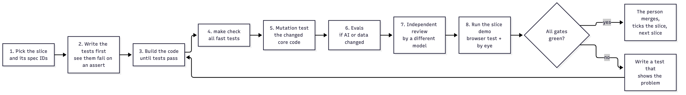
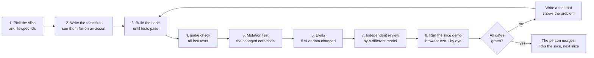

# 5. Test strategy — a closed loop that catches mistakes

We'll write most of the code with AI coding agents. They're fast, but they make confident mistakes, and they sometimes "fix" a failing test by weakening it. So the tests have two jobs:
1. Prove the code does what the [spec](01-SPEC.md) says.
2. Prove the tests themselves are strong enough to catch a mistake, and can't be quietly weakened.

## 5.1 The loop for every slice

Diagram source (mermaid — flowchart)

Rules for the loop:
- **Tests come first.** The agent adds the empty function or page first, so a new test fails on an assertion, not on a missing import. The PR description shows the red run, then the green one.
- **Every bug gets a test before its fix.** The test fails, then the fix makes it pass.
- **Protected files change only with the person's approval** (5.4). An agent can propose the change, but it can't approve it.

## 5.2 Kinds of tests

| Kind | What it proves here | Tool | Examples in this project | Runs |
|---|---|---|---|---|
| **Unit** | One function does the right thing | pytest | Address cleanup, permit rule table, money parsing, `next_state`, `check_signature` with the fixed test token | Pre-commit and every PR |
| **Property-based** | A rule holds for thousands of generated inputs, not just the cases we thought of | Hypothesis | See 5.3 | Every PR |
| **Stateful property** | Random sequences of clicks and events never break the job rules | Hypothesis `RuleBasedStateMachine`, compared with a separate simple model written in the test | See 5.3 | Every PR |
| **Golden set** | AI and data steps still give known-right answers | pytest + `evals/` | Regression invoices, address cases, permit-match cases, town replies | Every PR (replay) |
| **Snapshot** | Emails and reports don't change by accident | syrupy | Each email template's exact text, the report for each role | Every PR |
| **Integration** | Parts work together with a real database and mailbox | pytest + Testcontainers (Postgres, Mailpit) | `perform` writes one outbox row. The sender delivers to Mailpit. The seed loads. The trigger blocks edits to events. | Every PR |
| **Workflow** | Waits, reminders and clicks behave, with time skipped | Temporal `WorkflowEnvironment.start_time_skipping()` with **fake activities**, one environment per test module | No answer → 2 reminders → last wait → no answer. Late answer on day 20. Unsubscribe mid-way. Town waits 7 + 5 business days. | Every PR |
| **Workflow on the real server** | Things the time-skipping kit doesn't cover: Schedules, the sender, restarts | Dev server in Docker | Schedule creation is safe to repeat. Restarting Temporal mid-wait keeps the workflow. | Every PR (short), nightly (full) |
| **Workflow replay** | New code still understands old running workflows | Temporal `Replayer` on saved histories | Every waiting point and unusual path (design 3.8). Plus a deliberately incompatible change that must fail. | Every PR |
| **Chaos / crash** | No double-sends or lost work when things die | pytest + fault points + a small fake SMTP server (`aiosmtpd`) + `docker kill` | The fixed list of crash points (design 3.7). Killing the worker, the sender and Temporal. | Every PR (each point once, lease 5 s), nightly (each point 5×) |
| **Security / attack** | Planted text and bad links get nowhere | pytest + attack twins | Attack containment (evals 4.2). Tampered approvals. Guessed links. A link used for the wrong purpose. Another account's IDs. | Every PR |
| **Access** | Each role sees only what the access table allows | pytest calling the real routes | Every row of the access table in design 3.12, for pages **and** downloads | Every PR |
| **Architecture** | The "one door" rules hold | import-linter + AST checks | Only `perform` writes to `outbox`, `links` (share) and `town_requests`. Only `gateway/` imports model clients. `workflows/` does no I/O. No `datetime.now()` in activities. Event payload models have no person fields. | Every PR |
| **Config** | It only runs on this computer | pytest on `docker compose config` | Every port on 127.0.0.1. Postgres not published. Mailpit relay off. | Every PR |
| **Contract / API** | The web endpoints reject bad input without crashing | Schemathesis on the FastAPI schema | No 500s. Nothing works without a session or link. | Nightly |
| **Browser (e2e)** | A person can actually do it in the UI | Playwright (pytest-playwright), checking what's on the page | Contractor import → approve → homeowner confirms → marks show. Share link per role. Ask the town. Unsubscribe. | Every PR (key paths), nightly (all) |
| **Wording** | No banned phrases anywhere | `core/wording.py` run on every page and email the browser and simulator runs produce | R-COR-3 | Every PR |
| **Full demo (e2e)** | The whole thing runs from scratch like a new user's | `make demo` on a clean machine using the exact public files | Prints its pass/fail list. CI fails on any fail. | Nightly + each milestone |
| **Differential** | Two independent ways of doing the same thing agree | pytest | See 5.3 | Every PR / nightly |
| **Mutation** | The tests are strong enough: small code changes must make a test fail | mutmut 3 | `src/closeout/core/`. Target: ≥ 85% of changes caught. | Changed files per PR, everything nightly |
| **Data quality** | The real data still looks like we expect | pytest | Exact counts on the snapshot. Column check against the live feed. | Every PR (snapshot), nightly (live) |
| **Performance smoke** | Nothing got slow | pytest-benchmark | Building a home view from 1,000 events, matching all permits | Nightly |

**Not in Phase 1: pixel-by-pixel screenshot tests.** Playwright for Python doesn't compare screenshots by itself, and fonts differ between Mac and Linux. We check page content with Playwright instead, and keep screenshots for people to look at.

## 5.3 Properties and differential tests

**Properties that would catch real bugs.** Each one can fail:
- **Address cleanup:**
  - never changes or drops the house number or unit
  - running it twice gives the same result
  - neighbour numbers never match
- **Money:**
  - cleaning a formatted amount gives back the exact amount
  - nothing outside the limits is kept
- **Approvals:**
  - changing any byte of the token or any expected claim gives a refusal
  - a token checks out exactly until `exp`, then never again
- **`perform`:**
  - running the same command twice gives the same single outbox row
  - two different commands with one approval give one row and one `already_used`
- **Events:**
  - adding a duplicate event changes no view
  - a job's `status` always equals the status worked out from its events
- **Job rules** (stateful, compared with a simple model):
  - a `recorded` job always had a homeowner confirmation in the same round
  - nothing is sent after a decline, a "not my house", an unsubscribe or a suppression
  - a retracted job appears in no role's view
  - an undone round's marks never show
- **Reports:** a price the owner or homeowner hid appears in no rendered page or download.
- **Links:** a link for one purpose is refused at every other route.
- **Business days:**
  - adding n business days never lands on a weekend or holiday
  - it always moves forward
- Hypothesis settings: 200 examples per property on PRs, 2,000 nightly, failing examples saved in the repo.

**Differential tests (two ways, same answer)**

| What | Way A | Way B | Must agree on |
|---|---|---|---|
| Permit-to-parcel matching | SQL join in the app | `tools/join_check.py` (pure Python, public, reads only the seed files) | Every permit's status, exactly |
| Job status | `jobs.status` column | Worked out from the events | Every job after every simulator run |
| Invoice reading | Reader A | Reader B | In the product: disagreement → ask. In evals: agreement tracked. |
| Replay vs live | Saved answers | Live model run (on the Mac) | Kept facts. Differences show model drift. |
| Local vs hosted | Qwen3-VL | Hosted model | Accuracy and cost table |
| Old vs new code | Main branch | Pull request | Golden outputs. Any change must be explained in the PR. |

## 5.4 Guarding against weak or gamed tests

AI agents under pressure to "make it green" can weaken tests. These guards come from GitHub settings the agent can't change, plus simple checks:

| Guard | How |
|---|---|
| **The repo is public from day one** | Private material (`research/`, the first plan page) lives in a separate folder outside the repo. A public repo gets GitHub's rulesets and Actions minutes for free. `tools/publish_check.py` (run before every push, and in CI) checks for the private names, using a list kept outside the repo. |
| **The agent works from its own fork** | The agent has its own GitHub account (signed up in S0) and pushes only to its fork. It has no write access to the main repo, so it can't merge, label, approve in a way that counts, or change settings. |
| **Rules on `main`** (a checklist the person applies in S0) | Pull requests only. All required checks green. One approval from a code owner. Approvals are dismissed when new commits are pushed, and the most recent push must be approved. The owner can bypass the rules for their own pull requests (for things only the person changes: the status table, live eval reports, replay files recorded on the Mac). |
| **Protected paths** | `CODEOWNERS` names the person for: `tests/`, `evals/`, `tools/`, `.github/`, `Makefile`, `deploy/`, `.pre-commit-config.yaml`, `pyproject.toml`, `conftest.py`, `docs/01-SPEC.md`, `docs/06-IMPLEMENTATION-PLAN.md` (its status table switches requirements on), snapshot folders, saved histories and replay files. |
| **One trusted check** | The `gate` check runs from a `pull_request_target` workflow, which always uses `main`'s copy of the workflow file. It reads the pull request's diff through the GitHub API and **never runs the pull request's code**. It flags any change to a protected path and lists suspicious changes (next row). The other checks run the pull request's code, so they could be tampered with in the same pull request. That's why any change to `.github/`, `tools/` or the `Makefile` needs the person's approval. |
| **Every finished requirement is tested** | Tests carry two tags, `@pytest.mark.req("R-OUT-2")` and `@pytest.mark.slice("S6")`. `tools/trace.py` reads the spec's Slice column and the plan's status table. For every slice marked `done`, every requirement listing that slice must have at least one test with that pair that **ran and passed** in this CI run. Requirements of later slices are listed as "not yet". |
| **Suspicious changes are flagged** | A simple scan of the diff lists new or changed: `skip`, `xfail`, `pragma: no cover`, `pragma: no mutate`, `type: ignore`, `noqa`, lower thresholds, fewer Hypothesis examples, `assume(`, deleted asserts, deleted golden cases, and code moved out of `core/`. It doesn't decide anything. It posts the list on the PR, and each item needs the person's OK. |
| **Tests are strong** | Mutation score on `core/` must stay ≥ 85%. Score = caught ÷ (all mutants − ones excluded by name in a protected list). Survived, untested and suspicious mutants count as not caught. Timeouts count as caught but are listed. An empty or crashed mutation run fails. S0 proves the mutants are applied to the copied code that the tests actually import. Rule tables are written as functions so mutation reaches them. |
| **Coverage didn't drop** | Line + branch coverage on `core/`, `gateway/`, `activities/` must not drop. 90% on `core/`. |
| **No flaky tests** | A test that fails then passes on a rerun fails the build. Only the person can quarantine a test, and a quarantined test's requirement shows as untested. |
| **Independent review** | Each PR gets a review from a different AI model than the one that wrote it, against a fixed checklist: spec IDs covered, one-door rules, no personal data in histories or events, no secrets, error paths. Findings are fixed or answered before merge. |
| **A person merges** | Agents open pull requests. A person reads the summary, the flagged list and the slice demo, then approves and merges. |

## 5.5 Where each check runs

| Stage | Runs | Time budget |
|---|---|---|
| Pre-commit (on the agent's machine) | Format, lint (ruff), types (pyright), unit + property tests on changed files | < 1 min |
| Pull request CI (GitHub) | The `gate` check, everything marked "every PR", mutation on changed `core/` files, trace, replay evals (regression and development sets) | < 20 min, split across parallel jobs |
| Nightly CI (GitHub) | Full mutation, chaos 5× per point, 10 restart tests, Schemathesis, all browser tests, fresh-clone demo, live feed check | < 90 min (free for a public repo) |
| On the owner's Mac (`make eval-live`) | Live-model evals, attack resistance, cost and speed | Per milestone, and whenever prompts or models change |
| Milestone | Everything + Mac fresh-clone + a person follows the README + eval report review | Half a day |

## 5.6 Test data

- **Everything is made up** except the public permit and parcel data. All made-up people live in Sampleton and use `.example` or `.test` email addresses.
- Generators are seeded, so reruns are identical.
- Each test gets a fresh database (created from a template database, so it's fast), so no test depends on another.
- Replay files are recorded with `make record` on the Mac. They change only through a reviewed PR with the eval report attached.

**Document track (made by generator scripts, starting on day 1, alongside the code)**

No set needs hand work. A person only looks over a contact sheet of thumbnails for each set.

| Set | How many | Made by |
|---|---|---|
| Held-out invoices | 300 (100 development, 200 sealed outside the repo) | A second generator script, written by an agent working in a checkout that doesn't contain the first generator or the model test |
| Messy real-looking invoices | 30 | `make_messy.py` (below) |
| Attack twins | 60 pairs | A generator |
| Town replies | 30 | A generator, plus the messy-set damage recipes |

Needed by: held-out and attack sets by S3. Messy set by M2. Town replies by S11.

**Making the messy set** (research and a working prototype: `spikes/messy-docs/RESEARCH.md`)

1. **Truth first.** Write each invoice's 9 fields to `truth.json`, including the exact printed text of each field. All people and addresses are in Sampleton.
2. **Draw it clean** from the truth, as the model test did. The truth stays exact because we wrote the text.
3. **Damage it in code**, with a fixed seed per image. There are 6 kinds, about 5 images each:

| Kind | How it's made |
|---|---|
| Crumpled phone photo | Our own crumple-and-camera code (OpenCV), on a table or counter background |
| Folded letter with a coffee ring | Fold creases + a stain + the phone-photo step |
| Photocopy, fax or low-res scan | Augraphy (MIT), with tuned settings (its defaults are far too strong) |
| Handwritten carbon-copy invoice book | Handwriting fonts (Google Fonts, OFL or Apache), each letter slightly tilted and moved, with a faint offset copy for the carbon look |
| Printed form with handwritten fixes | The printed total crossed out and a new total written in. The truth is the new total. |
| Faded receipt | Faded ink, a curled strip, then the phone-photo step |

Some of these become 2–3 page PDFs, with the total on page 2.

4. **Readability check, with no person.** Tesseract and one strong hosted model must each try to read the image (allowed, because everything in it is made up). An image is kept only if a reader finds the total and at least 7 of the 9 fields. Otherwise the damage is softened and retried, up to 3 times, and then the image is rejected.
5. **Commit the images,** not just the script, because some effects vary slightly between machines.

**What we don't use:**
- Image-generation models to draw invoices. They often get digits wrong. They're fine for backgrounds only.
- Datasets of real invoices. None are home-repair invoices, several are non-commercial or unclear, and some contain real people's details.
- Handwriting AI models trained on the IAM dataset. Its terms allow non-commercial research only.

**Optional real-photo sanity check:** the CORD receipt photos (CC BY 4.0), downloaded at eval time, never committed, never sent to a hosted model, scored on the total only.

**Estimate:** about 1 day of agent work, alongside S1–S3.
