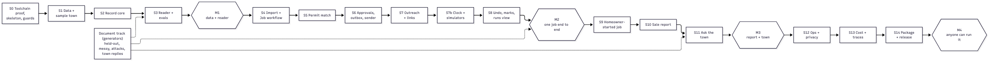

# 6. Implementation plan — slice by slice

Each slice:
- is small (1½–4½ days)
- leaves the product working
- can be checked on its own by commands anyone can run

Tests are tagged with their requirement and slice (`@pytest.mark.req("R-OUT-2")`, `@pytest.mark.slice("S6")`), so `make verify SLICE=S6` runs exactly that slice's acceptance checks. Every slice follows the loop in [05-TEST-STRATEGY.md](05-TEST-STRATEGY.md#51-the-loop-for-every-slice).

## 6.1 Overview

```mermaid
flowchart LR
    S0["S0 Toolchain proof,<br/>skeleton, guards"] --> S1["S1 Data +<br/>sample town"] --> S2["S2 Record core"] --> S3["S3 Reader +<br/>evals"]
    S3 --> M1{{"M1<br/>data + reader"}}
    M1 --> S4["S4 Import +<br/>Job workflow"] --> S5["S5 Permit match"] --> S6["S6 Approvals,<br/>outbox, sender"] --> S7["S7 Outreach<br/>+ links"] --> S7b["S7b Clock +<br/>simulators"] --> S8["S8 Undo, marks,<br/>runs view"]
    S8 --> M2{{"M2<br/>one job end to end"}}
    M2 --> S9["S9 Homeowner-<br/>started job"] --> S10["S10 Sale report"] --> S11["S11 Ask the town"]
    S11 --> M3{{"M3<br/>report + town"}}
    M3 --> S12["S12 Ops + privacy"] --> S13["S13 Cost + traces"] --> S14["S14 Package<br/>+ release"]
    S14 --> M4{{"M4<br/>anyone can run it"}}
    DT["Document track (generators)<br/>held-out, messy, attacks, town replies"] -.-> S3
    DT -.-> M2
    DT -.-> S11
```

Diagram source (mermaid — flowchart)

| Slice | Days | Spec IDs | Tables it creates |
|---|---|---|---|
| S0 Toolchain proof, skeleton, guards | 4.5 | R-OUT-7, R-SAFE-4, R-RUN-4, R-RUN-6 (stack restart proof) | `clock`, `people`, `accounts`, `commands` |
| S1 Data + sample town | 3 | R-DATA-1..6 | `towns`, `parcels`, `permits`, `permit_parcel`, `sync_runs`, `contractors`, `recipients`, `homes`, `grants` |
| S2 Record core | 2 | R-DATA-1 (events), R-REC-1, R-REC-2 (rules) | `events` |
| S3 Reader + evals | 4 | R-IMP-3 (reads), R-IMP-5, R-SAFE-1, R-RUN-2, R-OBS-1 | `jobs`, `documents`, `reads`, `facts`, `model_calls` |
| S4 Import + Job workflow | 3 | R-IMP-1..4, R-OPS-1 (list) | `import_batches`, `review_items` |
| S5 Permit match | 1.5 | R-COR-1..3 | — |
| S6 Approvals, outbox, sender | 4.5 | R-OUT-1 (one message), R-OUT-2, R-OUT-6, R-OUT-7, R-OPS-3, R-SAFE-2 | `approvals`, `outbox`, `links`, `suppression`, `audit_log` |
| S7 Outreach + links | 3.5 | R-COR-3 (all pages and emails), R-OUT-1 (sequence), R-OUT-3..5, R-SAFE-3, R-RUN-6 (with a waiting job) | — |
| S7b Clock + simulators | 2.5 | R-RUN-3, persona rows H1–H11 | — |
| S8 Undo, marks, runs view | 2 | R-REC-2 (pages), R-REC-3, R-OBS-2, persona H12 | — |
| S9 Homeowner-started job | 2.5 | R-IMP-6, persona K1 | — |
| S10 Sale report | 2.5 | R-REC-4, R-REP-1..3, R-SAFE-2 (shares), R-SAFE-3 (share links) | — |
| S11 Ask the town | 3 | R-TOWN-1, R-TOWN-2, personas T1–T3 | `town_requests` |
| S12 Ops + privacy | 3 | R-OPS-1 (ops pages), R-OPS-2 | — |
| S13 Cost + traces | 1 | R-OBS-3 | — |
| S14 Package + release | 3 | R-RUN-1, R-RUN-4, R-RUN-5 | — |
| **Total** | **45.5 days ≈ 9 weeks, plus a buffer week = plan for 10** | | |

**Why it grew again.** The second reviews found real work that wasn't in the slices:
- the click protocol
- per-round links
- the SMTP stage table and fake mail server
- the readers' own queue
- the sealed eval set
- the public-repo setup
- a design for S9
- moving the tables each check needs into the slice that checks it

S7 was split in two, because it had become the biggest slice. The plan is re-estimated after S0.

**Rough calendar:** M1 in week 3, M2 in week 7, M3 in week 8, M4 in week 10.

**The person's time** (not in the 45.5 days):

| What | Time |
|---|---|
| Reviewing and merging each slice | about 1 hour each, about 2 days in all |
| S0 setup: create the agent's GitHub account, apply the ruleset checklist, move private material out | about 2 hours |
| Each milestone: demo, reports, re-estimate | half a day each, 2 days in all |
| Live evals and replay recording on the Mac | about 2 hours per milestone |

That's about 5 days, spread over the 10 weeks.

## 6.2 The slices

### S0 — Toolchain proof, walking skeleton, guards (4.5 days)

The point of S0 is to prove every tool works on this layout **before** we rely on it, and to put the guards in place before agents write real code.

**Done by the person** (with a checklist the agent writes)
1. ~~Move the private material outside the repo.~~ Done on 27 Nov 2026.
2. Create the public GitHub repo, and a second GitHub account for the coding agent (signed up with the project's sign-up email, which is kept outside the repo). The agent works from its own fork.
3. Apply the `main` ruleset and `CODEOWNERS` (test strategy 5.4).

**Build**
- `uv` project with the `src/closeout/` layout
- docker compose:
  - Postgres
  - Temporal dev server with `--db-filename` on a volume (image tag pinned)
  - Mailpit with relay off and a database file on a volume
  - app, worker and a stub sender
  - every port on 127.0.0.1
- `make up`, `down`, `reset`, `keys`, `check`, `verify`, `demo` (stub)
- **Walking skeleton:**
  - demo sign-in (pick a person)
  - one page
  - one trivial workflow with a timer and an update, started from the page, using the click protocol (design 3.5) with a `commands` row
- The `clock` row and the virtual-time function
- Pydantic data converter set up in client, worker and tests
- Sender startup check
- Pre-commit (ruff, pyright)
- GitHub Actions:
  - the `gate` workflow on `pull_request_target`
  - tests on `pull_request`
  - a nightly job
- `tools/trace.py`, `tools/publish_check.py`, the mutation gate script
- MIT license, README skeleton, `.env.example`

**Tool proofs** (each a small test that stays in the repo)

| Proof | Passes when |
|---|---|
| Stack persistence | `make down && make up` while the trivial workflow waits on its timer. It still finishes once, and a test email sent before the restart is still in Mailpit. |
| Updates | An update with a fixed ID sent twice returns the first result. The validator rejects a bad request. A timeout while the worker is down, then the sweep, delivers it once. |
| Time-skipping | A 7-day timer test finishes in under 5 s on Mac and Linux CI. Updates work in the time-skipping kit (or we note that they don't and use the dev server for those tests). |
| Replayer | A saved history replays. A deliberately incompatible change fails the replay. |
| Testcontainers | Postgres and Mailpit start from pytest on Mac and Linux CI, and tests use their mapped ports. |
| Playwright | A browser test signs in and clicks through the skeleton in CI |
| mutmut | On a 20-line `core` module, the gate script reads the score from the copied code the tests import. A deliberately weak test makes the gate fail. An empty run fails. |
| Ollama from Docker | On the Mac, the worker container reaches Ollama on the host. The Linux setup is written down and tried once. |
| Network | `docker compose config` shows only 127.0.0.1 ports. The sign-in refuses a host not in `ALLOWED_HOSTS`. |
| Memory | Docker services' memory measured and written in the README |

**Verify**
- `make up && make check` is green on a fresh clone
- Every tool proof passes in CI
- In a scratch PR from the agent's fork that edits `tests/`, the `gate` check flags it, and GitHub blocks the merge until the person approves
- **Re-estimate the plan** with what S0 took

### S1 — Data + sample town (3 days)
**Build**
- `data/build_seed.py` and `data/SOURCES.md` with checksums
- Permit snapshot, keyed on `pk`, with trades from the fee columns
- `data/make_sampleton.py`: the sample town with its parcels, permits, people, accounts, grants, home owners and contractors
- `PermitSync` with the full-fetch compare (design 3.8) and its Schedule (paused in replay mode)
- `tools/join_check.py` (public, reads the seed files only)
- `/data` page with credits

**Tests**
- Unit (date cleanup, address cleanup, trades from fees)
- Properties (address cleanup keeps the house number and unit, and is idempotent)
- Integration (seed loads, the Schedule is safe to create twice)
- **Differential** against `join_check.py`, row by row
- Exact counts (R-DATA-2, R-DATA-3)
- Fake-API sync cases (R-DATA-1)
- Sampleton: same files on rerun, and no address shared with Manasquan

**Verify**
- `make verify SLICE=S1`
- `/data` shows 3,982 parcels, 3,362 with an address, 2,914 permits, and 2,712 / 82 / 120 links

### S2 — Home record core (2 days)
**Build**
- `events` with streams, the add-only trigger and event keys (design 3.9)
- `append_event`
- `core/record.py` with mark rules
- `core/jobs.py` with every state in design 3.4
- Permit events: backfilled from `permits`, and added by `PermitSync` from now on

**Tests**
- Unit per transition and per mark rule
- **Stateful property test** against a simple model in the test (test strategy 5.3)
- Properties: a duplicate event changes nothing, and status always equals the events
- Integration: the trigger blocks update and delete. A retried append adds nothing. A `seq` clash raises.
- **Mutation ≥ 85%** on `core/record.py` and `core/jobs.py`

**Verify:** `make verify SLICE=S2`, and the mutation gate passes.

### S3 — Reader + evals (4 days)
**Build**
- `gateway/` with replay, ollama and hosted providers, frozen prompts and schema, the replay key, `evals/models.lock`
- The `model-reads` task queue
- Tables `jobs`, `documents`, `reads`, `facts`, `model_calls`, and the kept / asked / unconfirmed rules (`core/compare.py`)
- `make record`, `make eval`, `make eval-live`
- Regression set (the 30 model-test invoices), development set, attack twins and the first 10 town replies loaded, with replay files recorded on the Mac
- The sealed set generated into the owner's private folder
- `evals/run_facts.py` and `evals/run_attacks.py`, with the case-list check

**Tests**
- Unit (compare rules, replay key: reader A and B never collide)
- Request bytes equal the stored example
- Replay miss fails loudly
- **3-page PDF read** fits the model's limits
- Town-reply prompt on 10 generated replies
- Architecture: only `gateway/` imports model clients
- Light mode keeps no fact without a person

**Verify**
- `make eval` (replay): reader A ≥ 97% on the regression set
- Reader-level E1 = 0 on the development set
- Reader-level attack containment = 0 (no kept fact changed)
- `make eval-live` on the Mac produces the first sealed-set E1 report

### ◆ Milestone M1 — data + reader (week 3)
**Demo**
- The `/data` page with real Manasquan numbers
- `make eval` showing one invoice read twice, with a disagreement turned into a question

**Gate:** S0–S3 checks pass, the sealed-set report has been read, and the plan is re-estimated.

### S4 — Contractor import + Job workflow (3 days)
**Build**
- `/c/import` (CSV columns and limits from design 3.16), with `pypdfium2` for PDFs
- `ImportBatch`, which starts one `Job` per job
- `Job` up to `ready` / `needs_a_look`
- Address matching and the same-contractor check
- `review_items`
- The command sweep and the startup check for jobs with no workflow
- `/c/review/<job>` (fix facts, and the light-mode review screen)

**Tests**
- Golden address cases, including neighbour houses
- Workflow tests (fake activities)
- A fix made after the batch ended still reaches the job
- A re-sent click returns the first result
- Limits (oversized, wrong type, too many or too big pages)
- An invoice naming another contractor opens a review item
- E1 through the full import on the development set
- **Playwright:** upload a CSV and 3 files → 2 ready, 1 needs a look

**Verify:** `make verify SLICE=S4`, with the Playwright video attached to the PR.

### S5 — Permit match (1.5 days)
**Build**
- `core/permits.py` with the four results
- The result on the job page
- The `pick_permit` command
- The contractor's stated-replacement line
- `core/wording.py`

**Tests**
- Rule table tests (each work type × trade, permits with no trade data)
- Sampleton cases with known answers
- False-match eval (evals 4.3)
- Roof and window statements (R-COR-2)
- Wording check on templates
- Mutation ≥ 85%

**Verify:** `make verify SLICE=S5`, and the false-match eval shows 0.

### S6 — Approvals, permission check, outbox, sender (4.5 days)
**Build**
- `core/approval.py` with the test vectors
- Ed25519 keys mounted one by one
- `closeout.act.perform` (design 3.6)
- Tables `approvals`, `outbox`, `links`, `suppression`, `audit_log`
- Sender service (claim with the job check, SMTP stage table, retry spacing, reaper, `delivered` signal, domain check)
- A minimal one-message workflow and a stub template with both link slots, so every crash point has a waiting workflow
- Approval page for a single message

**Tests**
- **Property:** any changed claim, byte or round is refused. A token that doesn't re-encode exactly is refused. The same command twice gives one row, even after expiry.
- Every refusal reason in design 3.6
- Contact edited after approval → the round's messages still go to the snapshot address
- Architecture: one door
- **Chaos:** every row of the crash table (design 3.7), using the fake SMTP server and a 5 s lease
- Planted addresses in the attack set are never recipients

**Verify:** `make verify SLICE=S6`, and `make chaos` passes every crash row, with 100% sent and no duplicates when nothing crashes.

### S7 — Outreach + links (3.5 days)
**Build**
- Outreach code inside `Job`, and the rest of `Job`: every state in design 3.4
- Approval page for the **whole sequence** (first email + 2 reminders)
- Email templates
- Links bound to the round, `/a/<token>` (confirm / correct / decline / not mine, price choice) and `/u/<token>` with one-click unsubscribe
- Cancellation of queued messages on every stop

**Tests**
- **Time-skipping workflow tests** for every answer path, no answer, an answer on day 20 and day 31, and a changed answer
- Unsubscribe mid-way, and the decline-while-queued race
- Reminders timed from delivery
- Snapshot tests of emails
- Sent body = approved template with only the 2 link slots different
- Link properties (purpose, round, expiry, opening changes nothing)
- Saved histories for **replay tests**
- Whole-stack restart while a job waits (R-RUN-6)
- Wording scan of every page and email in the run
- **Playwright** of the homeowner's phone flow

**Verify:** `make verify SLICE=S7`

### S7b — Clock + simulators (2.5 days)
**Build**
- Fast clock from the `clock` row, the banner and `/clock`
- The real-time floors (design 3.3)
- Homeowner and contractor bots following persona rows H1–H11
- `make sim`

**Tests**
- Clock table tests at each scale
- The bots' business days agree with the workflow's
- `make sim` checks every persona row exactly

**Verify:** `make verify SLICE=S7b`, and `make sim` passes H1–H11 with 0 sends to suppressed addresses.

### S8 — Undo, trust marks, runs view (2 days)
**Build**
- Undo window and new rounds
- `Retract` workflow
- Marks with links to their proof
- `/runs` from the database, with access rules and no personal details
- Persona H12

**Tests**
- Workflow tests: undo in time, too late, pressed in time but delivered late, an old-round link after an undo, retract
- Access tests on `/runs`
- **Playwright:** the full contractor → homeowner → marks path

**Verify**
- `make verify SLICE=S8`
- **The first full end-to-end browser test passes in CI**

### ◆ Milestone M2 — one job closed out end to end (week 7)
**Demo** (in Sampleton)
1. Import
2. Approve the email and reminders
3. The email arrives in Mailpit
4. Switch to the restart clock speed and run `make down && make up` mid-wait
5. Exactly one email and one reminder arrive
6. The homeowner confirms
7. 3 marks show
8. Undo within 60 s
9. The marks go and the job is back to ready

**Gate**
- E1 (sealed), E3, E4 (full, through sending) and E6 (H1–H12) on target
- Mutation ≥ 85% on `core/`
- The messy-set report has been read
- The plan is re-estimated

### S9 — Homeowner-started job (2.5 days, can cut)
**Build:** design 3.20. The homeowner uploads an invoice and picks the contractor from our list, then the contractor is asked to confirm through `/k/<token>`. Persona K1.

**Tests:** workflow, the contractor-confirm link, and Playwright.

**Verify:** `make verify SLICE=S9`

### S10 — Sale report (2.5 days)
**Build**
- `/h/report`
- Share links through `perform`, with roles, expiry and revoke
- `/r/<token>`
- `/h/claim` with a letter code

**Tests**
- **Access tests:** every row of the access table (design 3.12), for pages and downloads, with other accounts and guessed IDs
- Answer links give no home access
- Snapshot per role
- Revoked and expired links show nothing
- A hidden price appears nowhere (property)
- Playwright

**Verify:** `make verify SLICE=S10`

### S11 — Ask the town (3 days)
**Build**
- Business-day calendar on virtual dates
- `TownRequest` with outreach code
- Request and reminder templates
- `/t/<token>` clerk upload
- Town reply reading with the both-reads-agree rule
- Clerk bot (personas T1–T3)
- Report update with the source

**Tests**
- Business-day properties
- Time-skipping workflow tests (reply, reply after the reminder, late reply in the window, no reply)
- Town reply eval: 0 wrong results shown
- Playwright

**Verify:** `make verify SLICE=S11`, and `make sim` passes T1–T3.

### ◆ Milestone M3 — report + town (week 8)
**Demo:** the full mock story in Sampleton, including the sale report and the town reply.

**Gate:** every eval that exists by now is on target (privacy and packaging come next), and the plan is re-estimated.

### S12 — Ops + privacy (3 days)
**Build**
- `/ops` review list and `/ops/outbox` (for `unknown` and `on_hold`, with resend and stop)
- `PrivacyRequest` (design 3.17, including the erase marker and Mailpit deletion)
- The data-health page
- The redaction function

**Tests**
- **Privacy canary test** (R-OPS-2): database dump, uploads, Temporal history export, Mailpit and container logs. Traces are added when S13 is built.
- Payload models carry no person fields
- Playwright

**Verify:** `make verify SLICE=S12`, and the canary finds 0 hits.

### S13 — Cost + traces (1 day, can cut)
**Build**
- The cost and speed page per mode
- First measured numbers for hosted mode
- Optional Phoenix (IDs and timings only)

**Tests:** the page's numbers match `model_calls`, and traces hold no personal data (added to the canary).

**Verify:** `make verify SLICE=S13`

### S14 — Package + release (3 days)
**Build**
- `make demo` = `demo-run` (plays every role and prints the pass/fail list from the spec) + `demo-open`
- README:
  - quickstart
  - what you'll see
  - fix-it list
  - credits
  - notice
  - known demo limits (for example, a contractor could enter their own address and confirm their own job)
  - the hosted-mode warning
- The mock on GitHub Pages (prototype page only)
- Fresh-clone CI job
- A short demo video
- A security review pass and a secrets scan

**Tests**
- E5 fresh-clone ≤ 10 min on Linux CI and on a Mac
- `make reset && make demo` twice gives the same end-state summary
- A fresh AI agent in a clean virtual machine follows the README

**Verify:** a tagged release, and all evals green in the release report.

### ◆ Milestone M4 — anyone can run it (week 10)
The owner, acting as a newcomer, clones the public repo, runs `make demo` and sees the story with no help.

## 6.3 How we check we're on plan

| Check | How | When |
|---|---|---|
| **Slice done?** | All of these: `make verify SLICE=Sx` green in CI, every requirement for that slice has a passing test tagged with that pair, review findings closed, the slice demo recorded (Playwright video), and the person approved and merged it | Every slice |
| **Spec covered?** | `tools/trace.py` prints, for example, "S0–S6 done: 32 of 58 requirement–slice pairs required, 32 passing". Any required pair without a passing test fails CI. | Every PR, shown in the PR summary |
| **Quality held?** | The eval reports: every number in [04-EVALS.md](04-EVALS.md) against its target | Every PR (replay), each milestone (live) |
| **Time on plan?** | The table below: planned vs actual days per slice | Every slice |
| **Still the right plan?** | Milestone review: demo + eval report + re-estimate. Decide: continue, fix first, or change scope. | After S0, then M1–M4 |

**Stop and re-plan if:**
- a slice runs more than 50% over its estimate
- an eval misses its target at a milestone
- a milestone demo fails
- an S0 tool proof fails and there's no simple swap

| Slice | Planned days | Actual days | Status | PR |
|---|---|---|---|---|
| S0 | 4.5 | | not started | |
| S1 | 3 | | not started | |
| S2 | 2 | | not started | |
| S3 | 4 | | not started | |
| S4 | 3 | | not started | |
| S5 | 1.5 | | not started | |
| S6 | 4.5 | | not started | |
| S7 | 3.5 | | not started | |
| S7b | 2.5 | | not started | |
| S8 | 2 | | not started | |
| S9 | 2.5 | | not started | |
| S10 | 2.5 | | not started | |
| S11 | 3 | | not started | |
| S12 | 3 | | not started | |
| S13 | 1 | | not started | |
| S14 | 3 | | not started | |

`tools/trace.py` reads the **Status** column. A slice counts as done only when it says `done`. This file is a protected path, so only the person can change it.

## 6.4 How AI coding agents work on a slice

1. **Brief.** The agent gets the slice section, the spec IDs, the design sections it touches and the rules in this plan. Nothing else is assumed.
2. **Tests first.** The agent adds empty functions or pages, writes the tagged tests, and shows them failing on assertions.
3. **Build.** The agent writes code until `make verify SLICE=Sx` and `make check` pass.
4. **Self-check.** The agent runs mutation on the changed `core/` files, and the evals if AI or data changed, and attaches the reports.
5. **Review.** A different model reviews against the checklist (test strategy 5.4). The writing agent fixes the findings or answers them.
6. **Demo.** The agent records the slice's Playwright run.
7. **The person merges** after reading the summary, the `gate` check's flagged list, the demo and any changes to protected paths.

The agent works from its own GitHub account and fork. It can't merge, and it can't change tests, evals, gates or the spec without the person's approval, because GitHub requires the code owner's review for those paths.
